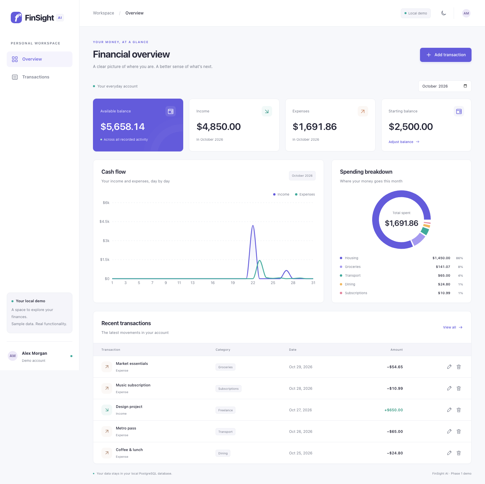

# FinSight AI

A personal finance workspace built with React, TypeScript, Java 21, Spring Boot, and PostgreSQL. Phase 1 delivers a functional local demo: record income and expenses, set an opening balance, and understand spending through interactive charts.

**Local demo only.** The application uses a clearly labelled Alex Morgan demo account. There is no production authentication. The API and database bind to loopback; do not expose them with tunnels, public interfaces, or deployment services. Phase 2A adds experimental, user-reviewed expense categorization. Phase 2B adds recurring income/expenses; Phase 2C adds deterministic future balance forecasts, planned one-time payments, and unsaved what-if comparisons. Phase 2D adds the interactive Bill Calendar. Phase 3 adds read-only Spending Insights with optional local statistical anomaly detection. Phase 4 adds a read-only deterministic offline financial assistant; no language model is installed or used.



[Dark mode](docs/screenshots/dashboard-dark.png) · [Mobile view](docs/screenshots/dashboard-mobile.png)

## Permanent operating requirements

FinSight AI is a private, single-user application running exclusively on the owner's MacBook with **$0 monthly operating cost**. All financial records, service communication, forecasting, and AI must remain local and work offline after initial installation. Cloud hosting, remote databases, external AI services, telemetry, and paid service dependencies are excluded.

[Repository-wide development requirements](AGENTS.md) govern all future work. The [local operation and macOS desktop plan](docs/local-operation.md) evaluates Tauri and records the remaining runtime packaging, service supervision, persistent storage, local security, and backup/restore work. Tauri packaging is deferred until after Phases 2B–2D and the local backup/restore phase. The final Applications app must start its own services and close normally without requiring Terminal, VS Code, or manual Docker/PostgreSQL/Java/Python startup.

Current browser development continues with the existing stack. Existing records must never be reset during updates, even when labelled demo. PostgreSQL has now been **backup/restored and verified** at `~/Library/Application Support/FinSight AI/postgres` on **127.0.0.1:55432**. The original `/tmp/finsight-pgdata` directory is stopped and retained. See the [migration report, backup location, startup, and recovery procedure](docs/database-migration.md). Phase 2E adds automatic local backups and isolated restore verification; desktop packaging remains future work.

## Features

- Responsive overview and transaction history, sidebar navigation, and persistent light/dark theme.
- Starting balance editor; income/expense creation, editing, and confirmed deletion.
- Available balance derived from opening balance + all recorded income − all recorded expenses.
- Selected-month income, expenses, daily cash flow, and category breakdown with Recharts tooltips.
- Transaction search by description/category, type filtering, and month selection.
- Loading, empty, validation, success, and retryable error states; accessible labels and native modal dialogs.
- PostgreSQL persistence, versioned Flyway migration, JPA validation, user-scoped queries, JSON problem responses, and decimal arithmetic.
- First-run sample data in the current month. Existing records and deletions survive restarts.

## Phase 2A: AI expense categorization

A separate Python/FastAPI service loads a saved TF-IDF + Logistic Regression model. The expense form shows optional suggestions and actual model confidence; it never changes a manually selected category automatically. Java applies timeouts, handles unavailable AI, maps model labels to existing categories, and records accepted/corrected feedback when an expense is saved. Feedback is unreviewed and never triggers automatic retraining.

[AI setup, architecture, API, evaluation, feedback, and limitations](docs/ai-categorization.md)

Quick start in another terminal, alongside the existing backend/frontend:

```sh
cd ai-service
python3 -m venv .venv
source .venv/bin/activate
pip install -r requirements-dev.txt
python train.py
uvicorn app.main:app --host 127.0.0.1 --port 8000 --no-access-log
```

Java defaults to `http://127.0.0.1:8000`; override with `AI_SERVICE_URL`. Try **Starbucks Coffee / 8.75** in Add transaction and review the suggested Food & Drinks → Dining category. The v1 held-out synthetic evaluation scored **45/45 classifications**, offering **43/45 suggestions** after abstention. Merchants/vocabulary overlap across the split; these numbers establish **no real-world accuracy claim**.

Run Python tests with `cd ai-service && python -m pytest -q` after installing development requirements. Use the native startup instructions below. Do not introduce Docker or replace the existing Homebrew installation.

## Phase 2B: recurring transactions

**Recurring Transactions** in the sidebar supports income and expenses with daily, weekly, every-two-weeks, twice-monthly, monthly, and yearly schedules. It includes configurable payment days, start/end dates, future-only edits, pause/resume/cancel, upcoming dates, and generated history. AI suggestions remain optional and never override manual categories. Summary amounts stay grouped by cadence.

Due dates post into the existing ledger automatically on backend startup and while running, including catch-up after closure. Permanent schedule/date receipts, row locks, and atomic transactions prevent duplicate postings. Explicit manual-payment linking or handled-only receipts prevent double-counting without guessing that similar transactions are duplicates.

[Phase 2B behavior, API, database changes, verified backup, tests, and limitations](docs/recurring-transactions.md)

The native PostgreSQL setup is unchanged. V3 added three empty recurring tables after a full verified backup; all existing financial records and balances were confirmed unchanged. No schedules or payments were seeded. New pre-V3 backups and retained restore mappings are under `~/Library/Application Support/FinSight AI/backups/phase2b-pre-v3-20261029T192555Z-378583/`.

## Phase 2C: future balance forecasting

**Balance Forecast** (`/#forecast`) projects actual ledger balance using exact recurring dates and separate planned income/expenses. Choose 1/3/5/6/12 months or a custom future date; inspect daily/monthly tables, chart tooltips, low-balance warnings, and unsaved baseline-versus-what-if comparisons. Plans change projections only and require explicit record/link/handled completion. Forecasts are read-only, use precise Java decimals, reuse Phase 2B recurrence rules, and need neither Python AI nor internet.

[Forecast methodology, UI, completion safety, API examples, tests, and limits](docs/balance-forecast.md). V4 adds two tables without altering financial records. See the [verified pre-V4 backup and integrity report](docs/database-migration.md#phase-2c-v4-upgrade). No Phase 2D calendar or desktop packaging is included.

## Phase 2D: interactive Bill Calendar

**Bill Calendar** (`/#calendar`) shows exact recurring/planned dates, recorded payments and completion markers, projected daily closes, monthly summaries, and low-balance warnings using the same Phase 2C forecast engine. Select a future date to add a plan; edit/cancel/complete/link through the existing workflow. Navigation supports months/years, today, keyboard control, desktop/mobile layouts, and dark mode. Historical balances are explicitly unavailable because the opening balance is undated.

No schema migration, new dependency/service, or personal test writes are needed. [Calendar guide, API, and limits](docs/bill-calendar.md) · [data-integrity report](docs/database-migration.md#phase-2d-read-only-calendar-update).

## Phase 2E: Backup & Recovery

**Settings → Backup & Recovery** (`/#settings`) provides asynchronous native PostgreSQL backups, daily scheduling/catch-up independent of the frontend, archive/full restore verification, safe configurable retention, optional verified SSD copies, and exact JSON/CSV exports. Existing migration archives are protected. A selected restore test first creates a verified current safety backup and restores only into new protected copies; live database replacement is unavailable. No schema migration is needed.

Defaults: 02:00 America/New_York; 7 daily, 4 weekly, 3 monthly periods; full restore test every 7 days. Managed backups are under `~/Library/Application Support/FinSight AI/backups/managed`. Backups are **unencrypted**. A disconnected verified SSD copy is necessary for protection from loss of the Mac itself. The owner-approved per-user backup LaunchAgent is installed and loaded; it checks independently of the frontend/backend. Changes to persistent services still require approval.

[Backup/recovery guide, APIs, scheduling/launchd, SSD workflow, exports, and limitations](docs/backup-recovery.md).

## Prerequisites

- Python **3.11** for the optional AI service.
- Java **21** and Maven **3.9+** (`java -version`, `mvn -version`).
- Node **22.x, version 22.12 or newer**, and npm.
- Homebrew PostgreSQL **15** for the migrated native cluster. Use the existing native installation; do not introduce Docker.

## Run locally

For the migrated personal database, use the existing persistent cluster; do not initialize a new database or switch to Docker's port 5432.

```sh
sh scripts/local-postgres.sh status
sh scripts/local-postgres.sh start
```

In a Java 21/Maven terminal at the repository root:

```sh
set -a
source "$HOME/Library/Application Support/FinSight AI/backend.env"
set +a
cd backend
mvn spring-boot:run
```

The private environment contains the generated local database credentials and selects the preserved database on 55432. Never print, commit, or put those credentials in command arguments. In another terminal:

```sh
cd frontend
npm ci
npm run dev
```

Open **http://127.0.0.1:5173**. Vite proxies `/api` to 127.0.0.1:8080. Start the optional AI service with the Phase 2A instructions above. The current personal database is preserved; it is not a fresh sample-data fixture. Keep all test writes and screenshots in separately initialized synthetic databases.

The [migration and recovery guide](docs/database-migration.md) gives the exact backup directory, verification command, native PostgreSQL procedure, and AI startup instructions. PostgreSQL must be stopped only after the backend and other database clients disconnect. No autostart/desktop launcher is implemented.

Legacy Compose files remain in source history but are not the supported operating/testing procedure. Keep the existing Homebrew cluster and isolated native test environment.

## Verify

Phase 2E verification passed: **131 backend tests on H2 and isolated PostgreSQL, 86 frontend tests, 35 backup-worker tests (six native integrations), 27 AI tests**, both production builds, and browser scenarios A–F. The first real managed backup was fully restored/verified without changing canonical financial records. The approved backup-only LaunchAgent is loaded. See the [Phase 2E verification report](docs/database-migration.md#phase-2e-backuprecovery-update).

Run the stdlib backup tests with `python3 -m unittest discover -s scripts/tests -v`. Six native PostgreSQL cases are opt-in and must use the existing isolated environment; a default run reports those as skipped. Never point backup integration tests at personal data.

Phase 2D verification passed: **123 backend tests on H2 and isolated PostgreSQL, 74 frontend tests, 27 AI tests**, both production builds, and synthetic browser acceptance. No schema change; all existing personal records/balances were verified unchanged. See the [calendar verification report](docs/database-migration.md#phase-2d-read-only-calendar-update).

Phase 2C verification passed: **95 backend tests on H2 and isolated PostgreSQL, 54 frontend tests, 27 AI tests**, executable backend packaging, and optimized frontend build. Synthetic browser acceptance covered forecast interactions and existing recurring/manual/AI workflows. See the [V4 integrity and test report](docs/database-migration.md#phase-2c-v4-upgrade).

```sh
cd frontend
npm test
npm run build
```

Stop the owned backend before `mvn verify` or `mvn package`: packaging must not replace a JAR that a running process is loading. Keep PostgreSQL running and preserve its data. Restart Java after the verified build.

```sh
cd backend
mvn verify
```

The backend suite starts the full application with MockMvc, Flyway, and H2 in PostgreSQL compatibility mode. It covers CRUD, exact decimal balances, starting balance changes, invalid values, category/type validation, calendar-month summaries, data isolation, and local access restrictions. Phase 1 tests roll back their changes; prediction integration tests clear their isolated synthetic fixtures.

For Phase 2B–2D PostgreSQL testing, reuse the already-existing isolated cluster under `/tmp/finsight-isolated-verification-12473ab7c796/postgres` on loopback port 55434 with its synthetic `finsight_verification` database. Do not initialize another cluster, use Docker, or repoint tests to the persistent personal cluster. If the existing isolated environment is unavailable, stop and report the limitation rather than bypassing the guard or creating a cluster. The test startup guard permits this dedicated location (or CI's ephemeral PostgreSQL container), and rejects personal clusters **before Flyway, seeding, or fixture deletes**. Neither preserved database named `finsight_test` is a safe test target.

Pass test credentials through the environment, not Java command arguments:

```sh
(
  export SPRING_DATASOURCE_URL=jdbc:postgresql://127.0.0.1:55434/finsight_verification
  export SPRING_DATASOURCE_USERNAME="$PG_TEST_USER"
  export SPRING_DATASOURCE_PASSWORD="$PG_TEST_PASSWORD"
  mvn test
)
```

The Phase 1 tests use rollback-only transactions; AI integration tests explicitly clear ledger/prediction tables in the isolated test database. Never point tests at your demo or personal database. CI runs both H2 and PostgreSQL 17, plus frontend tests, the production build, Python tests, and synthetic model training. CI derives a disposable test-service password from workflow run metadata; it contains no deployed credentials.

For a backend artifact, run `mvn package` and then `java -jar target/finsight-api-0.1.0.jar` with database environment variables exported. `npm run build` creates frontend assets in `frontend/dist`. Use `npm run dev` for the documented integrated local demo.

## Structure

```text
finsight-ai/
├── frontend/
│   ├── src/                 # App state, API client, formatting, styles, tests
│   │   └── components/      # Charts, cards, table, form, modal, icons
│   ├── package.json
│   └── vite.config.ts       # React, Tailwind, loopback dev proxy
├── backend/
│   ├── src/main/java/com/finsight/
│   │                        # REST controllers, service, entities, repositories, security
│   ├── src/main/resources/
│   │   ├── application.yml
│   │   └── db/migration/    # Flyway SQL
│   ├── src/test/            # Full-context API tests
│   └── pom.xml
├── ai-service/             # FastAPI inference, offline training, synthetic data, pytest
├── docs/
│   ├── architecture.md
│   └── api.md
├── .github/workflows/ci.yml
├── .env.example
└── compose.yaml
```

## Configuration

| Variable                                              | Purpose                         | Default                                     |
| ----------------------------------------------------- | ------------------------------- | ------------------------------------------- |
| `DB_URL`                                              | JDBC connection                 | `jdbc:postgresql://localhost:5432/finsight` |
| `DB_USERNAME` / `DB_PASSWORD`                         | Backend database credentials    | Required                                    |
| `POSTGRES_DB` / `POSTGRES_USER` / `POSTGRES_PASSWORD` | Compose database initialization | Required                                    |
| `PORT`                                                | Backend loopback port           | `8080`                                      |

If changing `PORT`, also change the Vite proxy target and allowed local origins. Prefer the documented default ports. Database initialization environment variables only apply to a fresh PostgreSQL volume; changing a password in `.env` does not change an existing database user's password.

## Scope and next steps

Phase 1 supports one demo user, one USD account, and predefined categories. Future-dated transactions are rejected. Available balance includes every recorded transaction; month selection changes charts, summary totals, and visible history, not that balance. Starting balance is an opening amount, not a transaction or a dated balance adjustment.

Recurring processing and deterministic forecasts are implemented. Phase 2D adds the interactive bill calendar. Continue calculation accuracy and regression testing. Phase 2E now adds automatic local backups and verified isolated restoration; continue recovery/offline acceptance before evaluating desktop packaging. Keep forecasts separate from posted transactions and support safe catch-up after the app has been closed. Cloud/AWS deployment and public exposure are excluded from the permanent architecture. Local application security should fit one MacBook and must not require hosted authentication.

See [architecture](docs/architecture.md), [API examples](docs/api.md), and [database migration/recovery](docs/database-migration.md).

## Phase 1 implementation verification

Verified on October 29, 2026 with Java 21 and Node 22:

- Backend: **14 tests passed** on both H2 and local PostgreSQL 15, including the actual Flyway migration; executable jar built successfully.
- Frontend: **3 unit tests passed**; TypeScript and optimized Vite build passed.
- Chromium smoke check: income/expense creation, edit, delete, opening balance updates, exact resulting balances, search, empty month, dark-mode persistence, mobile navigation and table scrolling, and API error/retry passed with no JavaScript runtime errors.
- Screenshots captured from the integrated application in light, dark, and mobile layouts.
- Frontend dependency audit: no reported vulnerabilities at verification time.

Docker was unavailable on the implementation machine, so Compose startup was not executed. The real PostgreSQL checks used an isolated local PostgreSQL 15 instance; CI is configured to repeat the suite on PostgreSQL 17. CI itself has not run remotely. Browser smoke tooling was temporary and is not a required project dependency; adding a maintained browser suite is a recommended next step.

## Phase 2A implementation verification

Executed locally on October 29, 2026:

- **30 Java tests passed** on H2 and again on isolated PostgreSQL 15: all 14 unchanged Phase 1 tests, six AI-client tests, and ten prediction/feedback integration tests. Both Flyway migrations and backend packaging passed.
- **27 Python tests passed**, covering model output/confidence, API contracts, validation, all categories, abstention, startup failures, and train/test vocabulary isolation. The upstream Starlette test client emitted one non-failing deprecation warning about its httpx adapter.
- **12 frontend tests passed**, including the three Phase 1 tests and nine form/suggestion cases. TypeScript and the production build passed.
- Real Chromium checks verified Python–Java–React predictions, explicit acceptance, manual corrections, stale results, unknown input, six dashboard/ledger snapshots, update/delete balances, and PostgreSQL feedback (one accepted, two corrected, all unreviewed).
- With the real AI process stopped, browser expense creation, editing, and deletion still worked; the backend returned `unavailable` within its timeout. The AI process was restarted afterward.
- Existing demo transactions and opening balance were preserved; verification-only entries and feedback were cleaned up.

Docker builds/startup and remote GitHub Actions were not executed here. Compose provides optional `ai` and `app` profiles; the default PostgreSQL-only workflow remains available.

## Persistent database and Phase 2A verification

The October 29, 2026 protection run completed a verified native PostgreSQL backup/restore cutover. All three databases, all 14 user-table row counts/content fingerprints, sequence states, and exact per-account balances matched the pre-migration snapshot; the normal frontend proxy returned the same account totals. The original directory remains stopped and intact. See the [migration report](docs/database-migration.md) for private backup paths, startup commands, and recovery instructions.

Executed results: **33 backend tests passed on H2 and again on an isolated PostgreSQL 15 cluster**, **12 frontend tests passed**, and **27 AI tests passed**. Backend packaging and optimized frontend builds passed. Browser regression checked 16 dashboard/ledger snapshots plus create/edit/delete, AI suggestions, manual overrides, feedback storage, stale/unknown inputs, mobile behavior, and real AI-outage fallback. All browser/test writes and screenshots used fresh synthetic data, never the preserved databases. The new test-startup guard rejects personal clusters before migrations or seeding. Startup-helper safety checks and the read-only backup verifier also passed.

The repeated synthetic model evaluation remained 45/45 classifications, with 43/45 suggestions after abstention; this is not evidence of real-world accuracy. One upstream Python test-client deprecation warning remains. Docker and remote CI were not executed. Automatic backup schedules/retention, encrypted backup management, durable developer-tool installation, and desktop packaging remain future work; no Phase 2B work was started.

## Phase 2B verification

Executed: **62 backend tests on both H2 and isolated PostgreSQL 15**, **27 frontend tests**, and **27 AI service tests**; backend and frontend production builds passed. Synthetic browser checks verified the new UI, explicit manual reconciliation, AI suggestions/overrides, unchanged legacy flows, mobile/dark mode, draft preservation during background refresh, and startup catch-up across service restarts without duplicates. Personal records were not used as test fixtures. V3 was applied only after a fully restore-verified backup; existing financial table fingerprints, exact balances, and PostgreSQL configuration remained unchanged. See the [Phase 2B report](docs/recurring-transactions.md).

## Phase 3: Spending Insights

Open [Spending Insights](http://127.0.0.1:5173/#insights) for exact recorded spending/income/net summaries, date-filtered category/monthly charts, evidence-backed observations, conservative local anomaly detection, and recurring analysis with separately labelled normalized estimates and exact pending totals. Insights do not write financial records; deterministic summaries remain available without Python. No schema migration or new dependency is required.

See [methods, APIs, controlled evaluation, tests and limitations](docs/spending-insights.md). The synthetic 240-case MAD benchmark measured 100% precision, 50.83% recall and 0% false-positive rate; limited history abstains and uneven/small-dollar cases are frequently missed. These figures do not measure real-world accuracy. Existing local startup, categorization model training and backup/recovery instructions remain unchanged. Phase 4 now adds the deterministic local assistant described below; savings goals and desktop packaging are deferred.

## Phase 4: local financial assistant

Open [AI Assistant](http://127.0.0.1:5173/#assistant) for supported spending/category/income, actual balance, forecast/low-balance, recurring/paycheck/bill, unusual-expense and hypothetical-purchase questions. Answers reuse existing financial services, show dates/evidence/source links and distinguish actual funds from projections and estimates. Category/date follow-ups use validated structured context. Chat stays in page memory and never changes financial records.

This is an offline **deterministic assistant, not an LLM**. No new runtime, download, dependency or migration is needed. Existing local startup remains unchanged. Optional Ollama/model installation requires separate approval; the [assistant guide](docs/financial-assistant.md) documents hardware assessment, supported language, privacy, tests and limitations. Phase 5 and desktop packaging are deferred.
