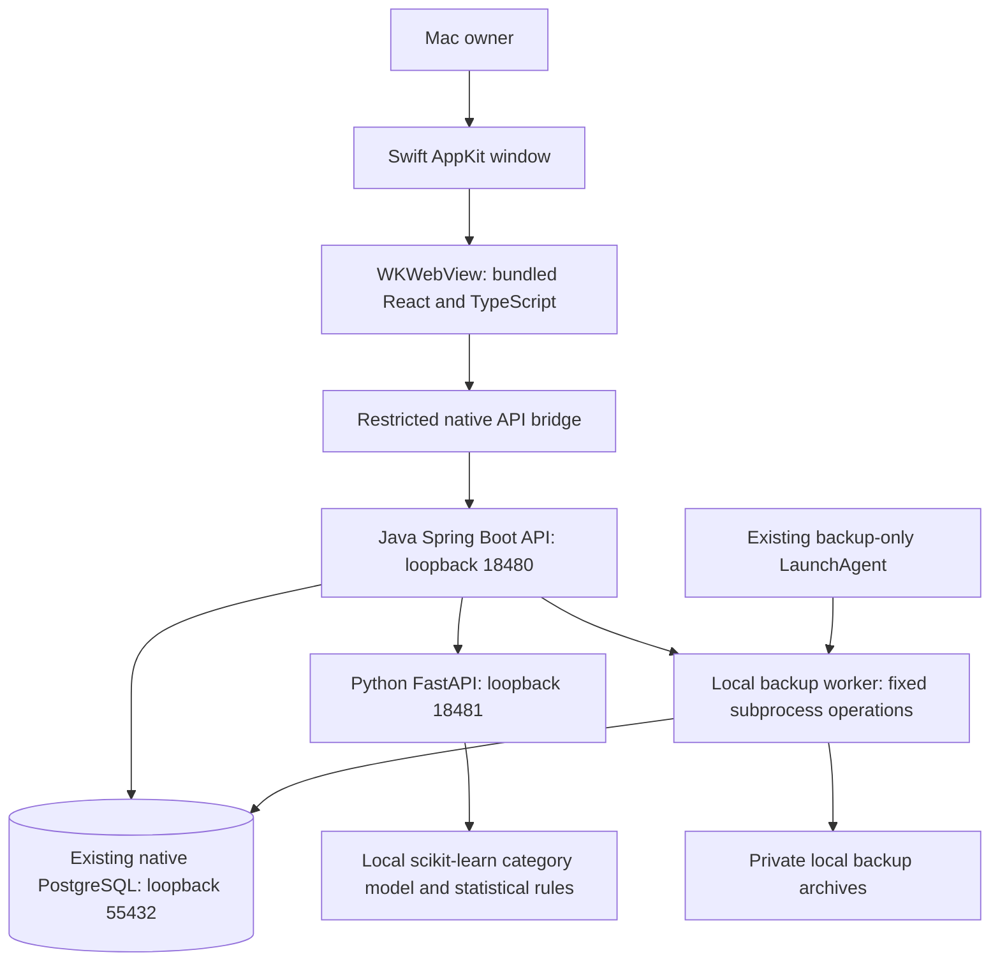
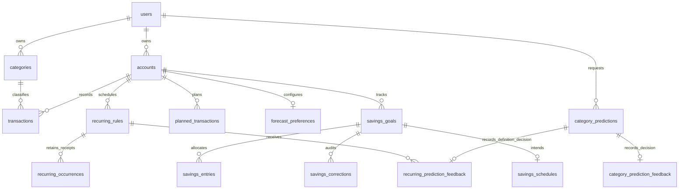
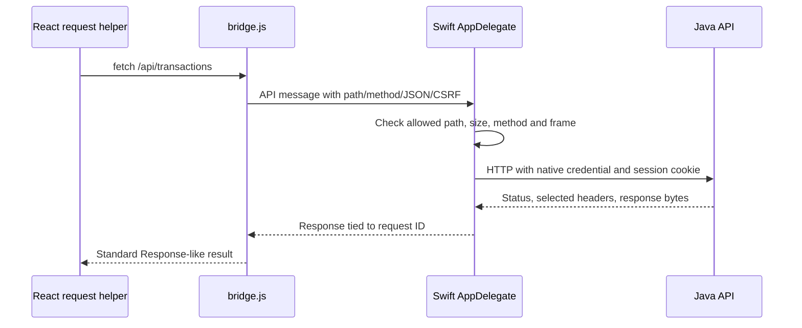

# FinSight AI: A Beginner’s Guide to the Codebase

*Source review: October 31, 2026. Covers the implemented Phase 6B application, including the default-category regression fix. This guide is documentation, not a proposal for Phase 7.*

All money examples are invented. No personal database was queried, application service launched, test executed, model trained, backup restored, or application installed to write this guide. Source files, schema definitions and tests are the evidence here. Existing completion reports describe separately executed verification.

## How to study this guide

You already know variables, loops, classes, methods and objects. We will use those ideas to connect a button to a database row, then connect individual features to the whole application. Read Chapters 1–7 first, follow the complete transaction journey in Chapter 12, and return to the financial and desktop chapters with that journey in mind.

A **path** tells you where a file lives. Links in this document point into this repository. In backend tables below, “Java directory” means [`backend/src/main/java/com/finsight/`](../backend/src/main/java/com/finsight/). A **service** can mean either a Java class containing business behavior or a separately running program; the surrounding explanation will distinguish them. A **ledger** is the collection of actual recorded income and expense transactions.

Names such as `App.load` and `App.saveTransaction` in this guide mean functions defined inside the `App` component, not exported static class methods. Similarly, `finance.cashFlow` identifies the helper exported by `finance.ts`.

Code examples are short, verbatim source excerpts, with surrounding code omitted where stated. They are reading exercises, not commands to paste into a live application. SQL excerpts explain the schema; do not run them against personal storage. Shell blocks are optional future development instructions, not actions performed for this guide.

## Contents

1. [Understanding FinSight AI](#chapter-1--understanding-finsight-ai)
2. [Understanding the project structure](#chapter-2--understanding-the-project-structure)
3. [Java backend explained](#chapter-3--java-backend-explained)
4. [React and TypeScript explained](#chapter-4--react-and-typescript-explained)
5. [PostgreSQL and database design](#chapter-5--postgresql-and-database-design)
6. [Python and AI categorization](#chapter-6--python-and-ai-categorization)
7. [Authentication and security](#chapter-7--authentication-and-security)
8. [Financial calculations](#chapter-8--financial-calculations)
9. [The macOS application](#chapter-9--the-macos-application)
10. [Backups and recovery](#chapter-10--backups-and-recovery)
11. [Testing](#chapter-11--testing)
12. [Follow a transaction through the entire application](#chapter-12--follow-a-transaction-through-the-entire-application)
13. [Important programming concepts](#chapter-13--important-programming-concepts)
14. [How to make changes safely](#chapter-14--how-to-make-changes-safely)
15. [Interview preparation: 25 questions](#chapter-15--interview-preparation-25-questions)
16. [Alphabetical glossary](#chapter-16--alphabetical-glossary)
17. [Learning exercises and separate answers](#chapter-17--learning-exercises-and-separate-answers)

# Chapter 1 — Understanding FinSight AI

## 1.1 The problem and the product

FinSight records income and expenses, calculates available cash, organizes recurring payments, and helps the Mac owner reason about future balances and savings. It combines a record book with planning tools. Entering an expense records something that happened. Creating a plan records an intention. Asking the assistant a question reads information. Those operations have different consequences, even when their screens look similar.

The application runs locally on one Mac, with multiple local login identities separating books on that Mac. It is not a public multi-user banking service. It does not import a bank feed, infer every purchase, or move money between real bank accounts. The owner supplies the financial records. Normal operation uses no cloud account, paid API, remote inference or telemetry.

The term **full stack** means the application contains both the visible interface and the programs that validate and store its data. FinSight has several cooperating parts:



Arrows show requests or access, not a transfer to the internet. Python inference has no database connection. The backup worker is a different Python program and deliberately uses native PostgreSQL tools for maintenance. That distinction prevents “Python has no database access” from being misunderstood as a statement about every script in the repository.

## 1.2 What each technology contributes

The code and project requirements establish the following roles. These are reasons the technology fits this design, not claims that the original author benchmarked every alternative.

| Technology | Plain-English role | Where to see it |
| --- | --- | --- |
| React | Builds the interface from reusable components and updates it when state changes | `frontend/src/App.tsx` |
| TypeScript | Checks shapes of JavaScript values during development | `frontend/src/api.ts` and feature type files |
| Vite | Runs the development frontend and builds static production assets | `frontend/vite.config.ts` |
| Tailwind and CSS | Supply styling tools and application styles | `frontend/src/styles.css`, Vite plugin |
| Recharts | Draws financial charts from prepared data | `frontend/src/components/DashboardCharts.tsx` |
| Java 21 and Spring Boot | Run the API, validation, authentication and financial services | `backend/pom.xml` |
| JPA/Hibernate and JdbcTemplate | Connect Java objects or explicit SQL to PostgreSQL | `Repositories.java`, `FinanceService.java` |
| PostgreSQL 15.17 | Stores durable relational records and enforces constraints | SQL migration directory |
| Flyway | Applies numbered database changes and checks migration history | `backend/src/main/resources/db/migration/` |
| Python 3.11 and FastAPI | Provide local prediction and spending-analysis endpoints | `ai-service/app/main.py` |
| scikit-learn | Implements the saved text classifier | `ai-service/train.py`, `ai-service/app/model.py` |
| Swift, AppKit and WKWebView | Provide the Mac window, menus, browser view and restricted native integration | `desktop/Main.swift` |
| Python standard library | Supervises processes and implements backup maintenance without another framework | `desktop/supervisor.py`, `scripts/backup_manager.py` |

## 1.3 Development mode versus the installed app

In browser development, Vite serves the frontend on `127.0.0.1:5173` and forwards `/api` requests to Java on `127.0.0.1:8080`. The optional development AI endpoint defaults to `127.0.0.1:8000`. An **endpoint** is a specific API operation reached through a path and HTTP method. A **runtime** is software needed to execute a program, such as the Java virtual machine. A **port** identifies one service on a machine; loopback addresses such as `127.0.0.1` refer to this same Mac.

In the desktop app, there is no Vite server. Java serves already-built frontend assets on port 18480, and bundled Python serves inference on 18481. The native bridge handles API calls. Both modes use the same core React components and Java services.

On opening the Mac app, Swift launches the supervisor, which verifies its runtime release, checks the existing PostgreSQL server and schema, starts Python and Java, and waits for **readiness**: evidence that the expected services are working. Then WebKit loads the interface. The login gate decides whether to show a financial workspace or the welcome screen. A new native launch requires login again because the native cookie store is temporary.

**Current boundary:** the personal desktop app refuses a stopped PostgreSQL server. It does not automatically initialize a cluster or silently start a new one. The established backup agent still has external runtime/repository dependencies. “Standalone window” does not mean every part of database and backup lifecycle is independent of the existing Mac installation.

# Chapter 2 — Understanding the project structure

## 2.1 A map of the repository

```text
finsight-ai/
  AGENTS.md                 permanent operating and preservation rules
  README.md                 overview, setup and historical feature records
  frontend/                 React, TypeScript, CSS, frontend tests
  backend/                  Java API, SQL migrations, backend tests
  ai-service/               FastAPI, classifier, synthetic training data, tests
  scripts/                  backup, migration and local maintenance tools
  desktop/                  Swift shell, bridge, supervisor, packaging, tests
  docs/                     architecture, contracts, acceptance and this guide
  .github/workflows/        source-only continuous integration configuration
```

A **build artifact** is generated output rather than the source you normally edit. Examples include `frontend/dist`, `backend/target` and `desktop/build`. Installed records and private configuration belong outside the checkout, under the existing Application Support directory. Do not treat a directory named “demo” or “test” as disposable personal storage.

## 2.2 Frontend files: what connects to what

| Actual file | Contents, purpose and when used |
| --- | --- |
| [`frontend/src/main.tsx`](../frontend/src/main.tsx) | Browser entry point. Mounts `AuthGate` and imports styles when the page starts. |
| [`frontend/src/components/AuthGate.tsx`](../frontend/src/components/AuthGate.tsx) | Checks a session, renders registration/login, and mounts or removes `App`. Runs before financial pages appear. |
| [`frontend/src/App.tsx`](../frontend/src/App.tsx) | Coordinates navigation, loaded account/category/ledger/summary data, transaction dialogs, refreshes and logout props. |
| [`frontend/src/api.ts`](../frontend/src/api.ts) | Shared request wrapper, CSRF handling, API errors and core types. Used whenever a component calls Java. |
| [`frontend/src/finance.ts`](../frontend/src/finance.ts) | Currency formatting, local-date formatting, money validation and dashboard cash-flow display data. |
| [`frontend/src/components/TransactionForm.tsx`](../frontend/src/components/TransactionForm.tsx) | Controlled transaction fields and submit logic. Used for adding/editing actual entries and as a reusable base in related forms. |
| [`frontend/src/hooks/useCategoryPrediction.ts`](../frontend/src/hooks/useCategoryPrediction.ts) | Debounced, cancelable prediction requests. Used while a valid expense description and amount are entered. |
| [`frontend/src/components/CategorySuggestion.tsx`](../frontend/src/components/CategorySuggestion.tsx) | Displays a suggestion, confidence, unavailable/abstention states and explicit acceptance. |
| [`frontend/src/components/CategorySetup.tsx`](../frontend/src/components/CategorySetup.tsx) | Submits a custom category and asks its parent to refresh. |
| [`frontend/src/components/TransactionTable.tsx`](../frontend/src/components/TransactionTable.tsx) | Shows recorded rows and edit/delete controls supplied by the parent. |
| [`frontend/src/components/SummaryCards.tsx`](../frontend/src/components/SummaryCards.tsx) and [`DashboardCharts.tsx`](../frontend/src/components/DashboardCharts.tsx) | Present prepared account/monthly figures rather than writing financial records. |
| [`frontend/src/components/Modal.tsx`](../frontend/src/components/Modal.tsx), [`Icon.tsx`](../frontend/src/components/Icon.tsx), [`styles.css`](../frontend/src/styles.css) | Shared dialog, visual symbols and styling. Used across feature pages. |

Feature modules follow a recognizable pattern: page component, supporting form/chart, and a type/helper file.

| Feature | Interface files | Shared contracts/helpers |
| --- | --- | --- |
| Recurring | `frontend/src/components/RecurringTransactions.tsx`, `RecurringForm.tsx` | `frontend/src/recurring.ts`, recurring types in `api.ts` |
| Forecast/plans | `frontend/src/components/BalanceForecast.tsx`, `ForecastChart.tsx`, `PlannedTransactions.tsx`, `PlanForm.tsx` | `frontend/src/forecast.ts` |
| Calendar | `frontend/src/components/BillCalendar.tsx` | `frontend/src/calendar.ts` |
| Spending | `frontend/src/components/SpendingInsights.tsx`, `SpendingCharts.tsx` | `frontend/src/insights.ts` |
| Assistant | `frontend/src/components/FinancialAssistant.tsx` | `frontend/src/assistant.ts` |
| Savings | `frontend/src/components/SavingsGoals.tsx`, `SavingsForms.tsx`, `SavingsCharts.tsx`, `SavingsAllocation.tsx` | `frontend/src/savings.ts` |
| Maintenance | `frontend/src/components/BackupRecovery.tsx` | Java backup API and native directory/export support |

In rows with abbreviated filenames, the containing directory is the one shown at the start of that cell. Navigation mounts these pages when their hash is selected; they do not all represent independently running services.

## 2.3 Java files by responsibility

The following files live in the Java directory defined at the beginning of the guide. A controller receives requests; its matching service implements the behavior; a `*Models.java` file defines request/response records.

| Files | Why they exist and when called |
| --- | --- |
| `FinSightApplication.java` | Starts Spring Boot and its managed objects. |
| `FinanceController.java`, `FinanceService.java`, `ApiModels.java` | Core account/category/transaction APIs and monthly summaries. |
| `Account.java`, `Category.java`, `Transaction.java`, `TransactionType.java` | Persisted entity types and income/expense enum. |
| `Repositories.java` | All five Spring Data repository interfaces; there is no separate `CategoryRepository.java`. |
| `AuthenticationController.java`, `AuthenticationService.java`, `LocalPasswords.java` | Session endpoints, registration/login and password hashing. |
| `SecurityConfig.java`, `CurrentIdentity.java` | Request filters, permissions and backend-derived owner identity. |
| `DefaultCategories.java`, `DemoIdentity.java` | Public default vocabulary and preserved legacy identifiers. Legacy identifiers are not a login bypass. |
| `CategoryPredictionController.java`, `CategoryPredictionService.java`, `AiServiceClient.java`, `AiModels.java` | Request a model result, validate/map it, store prediction metadata and feedback. |
| `RecurringController.java`, `RecurringRuleService.java`, `RecurringRule.java`, `RecurringModels.java` | Manage definitions, state and reconciliation. |
| `RecurringProcessor.java`, `RecurrenceDates.java`, `RecurrenceFrequency.java` | Startup/poll processing, shared date math and allowed cadences. `RecurringProcessor.java` also contains clock/runner classes. |
| `ForecastController.java`, `ForecastService.java`, `ForecastModels.java` | Forecasts, hypothetical comparisons and preference APIs. Controller also exposes planned-transaction routes. |
| `PlannedTransaction.java`, `PlannedTransactionService.java` | Persistent plans and explicit completion behavior. |
| `CalendarController.java`, `CalendarService.java`, `CalendarModels.java` | Compose a month from existing forecast calculations, actual rows and receipts. |
| `SpendingController.java`, `SpendingService.java`, `SpendingModels.java`, `SpendingAiClient.java` | Exact spending reports plus optional, independently validated statistical evidence. |
| `AssistantController.java`, `AssistantParser.java`, `AssistantService.java`, `AssistantModels.java`, `SavingsAssistant.java` | Allowlisted questions routed to existing read-only calculation sources, including savings. |
| `SavingsController.java`, `SavingsService.java`, `SavingsModels.java` | Separate goal/allocation book and projections. |
| `BackupController.java`, `BackupService.java`, `BackupWorker.java` | HTTP maintenance controls, asynchronous jobs and a restricted subprocess bridge. |
| `DesktopController.java` | Readiness endpoint with the current launch instance identifier. |
| `ApiExceptionHandler.java` | Converts selected validation, parsing and optimistic-conflict failures into structured errors. |
| `LocalCredentialTool.java` | Deliberate local provisioning of the preserved legacy identity, not ordinary registration. |

## 2.4 Configuration, AI, maintenance and desktop

| Path | What it contains and when used |
| --- | --- |
| [`backend/pom.xml`](../backend/pom.xml) | Maven dependencies and build plugins. Maven reads it for compilation, tests and packaging. |
| [`backend/src/main/resources/application.yml`](../backend/src/main/resources/application.yml) | Java defaults and environment placeholders. Spring reads it on startup. Never confuse its fallback JDBC URL with the authoritative personal configuration. |
| [`backend/src/test/resources/application-test.yml`](../backend/src/test/resources/application-test.yml) | In-memory test defaults; disables recurring/backup background writes in that test profile. |
| [`backend/src/main/resources/db/migration/`](../backend/src/main/resources/db/migration/) | Immutable V1–V7 SQL history, used by Flyway. |
| [`frontend/package.json`](../frontend/package.json), [`vite.config.ts`](../frontend/vite.config.ts) | npm scripts/dependencies and loopback build/dev configuration. TypeScript configs and lockfile make builds reproducible. |
| [`ai-service/app/main.py`](../ai-service/app/main.py) | FastAPI app factory, input schemas, startup model loading and three HTTP endpoints. |
| [`ai-service/app/model.py`](../ai-service/app/model.py) | Loads trusted local classifier artifacts and implements inference/abstention. |
| [`ai-service/app/spending.py`](../ai-service/app/spending.py) | Stateless median/MAD anomaly rules; no learned spending model or descriptions. |
| [`ai-service/train.py`](../ai-service/train.py), [`data/README.md`](../ai-service/data/README.md) | Explicit synthetic-data training and evaluation explanation. The CSV dataset is synthetic, not an export of personal purchases. |
| [`ai-service/artifacts/evaluation.json`](../ai-service/artifacts/evaluation.json), [`evaluate_spending.py`](../ai-service/evaluate_spending.py) | Saved category evaluation metadata and a separate spending-method evaluation program. |
| [`ai-service/requirements.txt`](../ai-service/requirements.txt), [`requirements-dev.txt`](../ai-service/requirements-dev.txt) | Runtime and testing dependencies. |
| [`scripts/backup_manager.py`](../scripts/backup_manager.py) | Core `Manager` for backup, verification, isolated restoration, retention, schedules and exports. |
| [`scripts/verify-database-backup.py`](../scripts/verify-database-backup.py) | Narrow verification utility for existing backup evidence; not a general live restore. |
| [`scripts/local-postgres.sh`](../scripts/local-postgres.sh) | Explicit status/start/stop of the existing persistent cluster; never creates one. |
| [`scripts/configure-legacy-login.py`](../scripts/configure-legacy-login.py) | Interactive wrapper for deliberate legacy credential setup. |
| [`scripts/apply-account-authentication.py`](../scripts/apply-account-authentication.py), [`AuthenticationMigration.java`](../scripts/AuthenticationMigration.java) | Specific V6-to-V7 maintenance path with safety backup/preservation checks. Not a reusable “run on every startup” command. |
| [`scripts/prepare-backup-launchagent.py`](../scripts/prepare-backup-launchagent.py) | Prepares a plist for the approved backup-only macOS job. Reading it is not authorization to install or change services. |
| [`desktop/Main.swift`](../desktop/Main.swift), [`Icon.swift`](../desktop/Icon.swift) | Native application delegate, windows/bridge/lifecycle and build-time icon generation. |
| [`desktop/bridge.js`](../desktop/bridge.js) | Adapts frontend API fetches to the restricted native message channel. |
| [`desktop/supervisor.py`](../desktop/supervisor.py) | Verifies and supervises owned local processes. |
| [`desktop/package.py`](../desktop/package.py), [`install.py`](../desktop/install.py) | Copy/relocate/sign existing runtimes and safely stage/replace the application bundle. |
| [`desktop/backup-launcher.sh`](../desktop/backup-launcher.sh) | Prepared backup-only launcher, not a PostgreSQL/Java autostart service. |
| [`frontend/src/components/TransactionForm.test.tsx`](../frontend/src/components/TransactionForm.test.tsx) | Example colocated frontend test. Other feature tests follow the same naming pattern. |
| [`backend/src/test/java/com/finsight/`](../backend/src/test/java/com/finsight/), [`ai-service/tests/`](../ai-service/tests/), [`scripts/tests/`](../scripts/tests/), [`desktop/tests/`](../desktop/tests/) | Tests for each boundary; Chapter 11 explains which can mutate synthetic fixtures. |
| [`.github/workflows/ci.yml`](../.github/workflows/ci.yml) | CI jobs operating on source and synthetic fixtures. Remote CI is not a normal application dependency. |

Legacy `compose.yaml` and Dockerfiles exist, but are not the authorized native Mac development or verification path. Generated runtimes, binary model weights and screenshots are not suitable places to edit application behavior. For deeper contracts, use [architecture](architecture.md), [forecast](balance-forecast.md), [calendar](bill-calendar.md), [spending](spending-insights.md), [assistant](financial-assistant.md), [savings](savings-goals.md), [authentication](account-authentication.md), [backups](backup-recovery.md) and [desktop packaging](macos-packaging.md).

# Chapter 3 — Java backend explained

## 3.1 From a Java program to an API server

A **framework** supplies common machinery so application code can focus on its rules. Spring Boot starts a web server, discovers annotated classes, connects dependencies and configures database integration. An **annotation**, such as `@Service`, is metadata that a framework reads; it is not a comment.

**Example 1 — [backend/src/main/java/com/finsight/FinSightApplication.java](../backend/src/main/java/com/finsight/FinSightApplication.java#L5), source excerpt:**

```java
public class FinSightApplication {
    public static void main(String[] args) { SpringApplication.run(FinSightApplication.class, args); }
```

Read the excerpt in order: the class names the application; the `main` method is Java’s entry point; `SpringApplication.run` starts the framework with that class and command-line arguments. The preceding source annotation enables Boot discovery and excludes the default generated-user authentication configuration. FinSight supplies its own authentication instead.

When Spring starts, it creates managed objects called **beans**. A constructor states what an object needs. **Dependency injection** means Spring supplies those objects rather than each class creating its own database or service instance.

**Example 2 — [backend/src/main/java/com/finsight/FinanceController.java](../backend/src/main/java/com/finsight/FinanceController.java#L12), source excerpt:**

```java
class FinanceController {
    private final FinanceService service;
    FinanceController(FinanceService service) { this.service = service; }
```

Line 1 identifies the controller class. Line 2 declares a reference that cannot later be reassigned. Line 3 receives the existing `FinanceService` and stores it. The constructor does not create a second service. The source annotations immediately above this excerpt mark it as a REST controller rooted at `/api`.

This allows testing and separation: the controller can receive HTTP input while `FinanceService` concentrates on financial rules. A constructor is a special initializer, whereas `create`, `list` and `account` are ordinary methods called after initialization.

## 3.2 Controllers, HTTP and JSON

**HTTP** is the request/response protocol used by the browser/native client and the local API. A **REST API** exposes resources through paths and methods. FinSight follows this style but also has deliberate action endpoints such as completing a plan. It is not necessary for every operation to be a pure table CRUD endpoint.

| Request | Meaning in this application | Typical success |
| --- | --- | --- |
| `GET /api/categories` | Read the authenticated owner’s categories | 200 |
| `GET /api/account` | Read opening balance and calculated cash totals | 200 |
| `POST /api/transactions` | Create an actual entry | 201 with Location header |
| `PUT /api/transactions/{id}` | Update an owned actual entry | 200 |
| `DELETE /api/transactions/{id}` | Delete an owned actual entry | 204, no response body |
| `GET /api/summaries/monthly?month=2026-10` | Read selected-month totals | 200 |

For the other features, use this route map as a reading index. These routes all require the existing session/CSRF/native controls appropriate to their method; a POST can carry a read-only question or hypothetical, so HTTP method alone does not tell you whether financial records change.

| Feature/controller | Implemented routes to trace |
| --- | --- |
| AuthenticationController | `GET /api/auth/csrf`, `GET /api/auth/me`, `GET /api/auth/session`; `POST /api/auth/register`, `/api/auth/login`, `/api/auth/logout`. |
| CategoryPredictionController | `POST /api/category-predictions`; model metadata can be persisted without a ledger write. |
| RecurringController | GET/POST `/api/recurring-transactions`; GET/PUT `/{id}`; PUT `/{id}/state`; POST `/{id}/stop`, `/{id}/reconcile`, `/process-due`; GET `/{id}/history`, `/{id}/occurrences` under that root. |
| ForecastController | GET `/api/forecasts`, `/api/forecasts/monthly`, `/api/forecasts/daily/{date}`; POST `/api/forecasts/scenarios`; GET/PUT `/api/forecast-preferences`. |
| ForecastController → PlannedTransactionService | GET/POST `/api/planned-transactions`; PUT `/{id}`; POST `/{id}/cancel`, `/{id}/complete` under that root. |
| CalendarController | `GET /api/calendar?month=YYYY-MM`. |
| SpendingController | GET `/api/insights` and `/api/insights/transactions`, with validated range/evidence parameters. |
| AssistantController | `POST /api/assistant/questions`; a read-only dispatch, not chat persistence or a mutation command. |
| SavingsController | GET/POST `/api/savings-goals`; GET/PUT `/{id}`; POST `/{id}/state`, `/{id}/entries`, `/{id}/entries/{entryId}/correct`; PUT `/{id}/schedule` under that root. |
| BackupController | GET/POST `/api/backups`; PUT `/settings`; POST `/{id}/verify`, `/{id}/restore-test`, `/external-copy`, `/exports`; GET `/exports/{name}` under that root. |
| DesktopController | `GET /api/desktop/health`; launch readiness, not personal financial data. |

A request can carry **JSON**, a text format containing objects, arrays, strings, numbers, booleans and null. The frontend sends an amount as a string, such as `"50.00"`, to preserve the typed decimal value. Java converts it into `BigDecimal` through JSON deserialization. A **DTO**—data transfer object—is a boundary shape such as `TransactionInput`; it is not automatically a database row.

**Example 3 — [backend/src/main/java/com/finsight/ApiModels.java](../backend/src/main/java/com/finsight/ApiModels.java#L8), source excerpt:**

```java
    public record TransactionInput(
        @NotBlank @Size(max = 160) String description,
        @NotNull @DecimalMin("0.01") @Digits(integer = 12, fraction = 2) BigDecimal amount,
        @NotNull TransactionType type,
        @NotNull UUID categoryId,
        @NotNull @PastOrPresent LocalDate date, UUID predictionId) {}
```

Line 1 declares an immutable Java `record`. Each following field becomes a value and an accessor such as `input.amount()`. Line 2 rejects blank descriptions and limits length. Line 3 requires a positive amount with at most twelve integer digits and two decimal digits. Lines 4–5 require a direction and category ID. Line 6 requires a nonfuture actual transaction date; the optional prediction ID attaches feedback. The controller’s `@Valid @RequestBody` asks Spring to deserialize and validate before entering service behavior.

Validation happens at several layers for different reasons. Browser checks give quick feedback. Java verifies untrusted requests. Database constraints prevent invalid stored relationships even if a programming mistake reaches SQL.

## 3.3 Entities and repositories

An **entity** maps to a database table through JPA, the Java Persistence API. Hibernate implements that mapping. FinSight’s entities usually store related UUIDs directly; they do not rely on a large graph of `@OneToMany` objects.

**Example 4 — [backend/src/main/java/com/finsight/Transaction.java](../backend/src/main/java/com/finsight/Transaction.java#L7), source excerpt:**

```java
@Entity @Table(name = "transactions")
class Transaction {
    @Id UUID id;
    @Column(nullable = false) UUID userId;
    @Column(nullable = false) UUID accountId;
```

Line 1 marks the class as an entity and names its table. Line 2 opens the class. Lines 3–5 identify the row and record its owning user/account. `UUID` is an identifier type designed to make unique values without a central counter. Other lines in the file store category, amount, direction, date and creation time; `@Version` supports detection of conflicting updates. A protected no-argument constructor lets the persistence framework instantiate the entity.

An **interface** states a contract without providing every implementation. Spring Data creates repository implementations at runtime.

**Example 5 — [backend/src/main/java/com/finsight/Repositories.java](../backend/src/main/java/com/finsight/Repositories.java#L14), source excerpt:**

```java
interface CategoryRepository extends JpaRepository<Category, UUID> {
    List<Category> findByUserIdOrderByName(UUID userId);
    Optional<Category> findByIdAndUserId(UUID id, UUID userId);
}
```

Line 1 inherits general persistence operations from `JpaRepository`, using `Category` as the entity and `UUID` as the identifier. Line 2 asks for a user’s categories in name order. Line 3 asks for both an identifier and its owner. Line 4 closes the interface. Spring interprets these method names and builds queries. `Optional<Category>` means “a matching category may be absent”; it prevents pretending a foreign or missing ID is a valid row.

For complex operations FinSight also uses `JdbcTemplate`, a Spring helper for explicit SQL. Repository-based persistence and explicit SQL coexist. For example, forecast receipts and many savings operations use SQL, while ordinary transaction entities use a repository. A `?` SQL placeholder binds a value separately from command text; it does not splice a description into executable SQL.

## 3.4 Services and database transactions

A **database transaction** is an all-or-nothing unit of changes. This is different from a financial transaction row. If an expense and its prediction feedback must be saved together, a failure should not leave only half the operation committed.

**Example 6 — [backend/src/main/java/com/finsight/FinanceService.java](../backend/src/main/java/com/finsight/FinanceService.java#L55), source excerpt:**

```java
    @Transactional
    TransactionView create(TransactionInput input) {
        accountEntity();
        Transaction t = new Transaction(); t.id = UUID.randomUUID(); t.userId = CurrentIdentity.userId();
        t.accountId = CurrentIdentity.accountId(); t.createdAt = Instant.now();
        apply(t, input); transactions.saveAndFlush(t); predictions.recordFeedback(input.predictionId(), t); return view(t);
    }
```

Line 1 selects a read/write transaction for this method; the class otherwise defaults to read-only. Line 2 declares that input produces a `TransactionView`. Line 3 verifies the owned account. Line 4 creates a new entity and assigns server-generated row and owner IDs. Line 5 assigns the account and timestamp. Line 6 validates/applies fields, flushes the entity to SQL, records optional feedback, and returns a response shape. Line 7 closes the method.

`saveAndFlush` asks Hibernate to send pending changes to the database now; **flush is not the same as commit**. A later feedback exception can still roll the whole service transaction back. Spring normally applies `@Transactional` through a wrapper called a proxy. That is why service boundaries and calls between beans matter: reading an annotation is not proof that every possible direct constructor call has a Spring-managed transaction.

`apply` checks the category belongs to the current user and matches INCOME or EXPENSE. `owned` checks transaction ID, user ID and account ID together before editing, deleting or returning a row. Client JSON does not choose ownership.

## 3.5 Exceptions and understandable responses

An **exception** interrupts the normal return path when an operation fails. FinSight uses `ResponseStatusException` for errors such as a missing owned record or mismatched category. `ApiExceptionHandler` handles selected errors centrally.

**Example 7 — [backend/src/main/java/com/finsight/ApiExceptionHandler.java](../backend/src/main/java/com/finsight/ApiExceptionHandler.java#L16), source excerpt:**

```java
    @ExceptionHandler({HttpMessageNotReadableException.class, MethodArgumentTypeMismatchException.class})
    ProblemDetail malformed(Exception ex) { return ProblemDetail.forStatusAndDetail(HttpStatus.BAD_REQUEST, "Invalid request format or value"); }
```

Line 1 identifies malformed JSON/type-conversion failures. Line 2 returns a generic HTTP 400 problem body. This prevents leaking parser internals while telling the interface that the request is invalid. Other handler methods return validation field messages and 409 for optimistic-lock conflicts. Security filters may instead return 401/403 directly; not every error comes from this advice class.

**Checkpoint:** explain “financial transaction,” “database transaction,” and “HTTP request” without using the three terms interchangeably.

# Chapter 4 — React and TypeScript explained

## 4.1 Components, JSX and props

A **React component** is a function that returns a description of interface elements. Its markup-like syntax is **JSX**, compiled into JavaScript. A component is not a server and does not directly open PostgreSQL.

`TransactionForm` receives **props**: values/functions supplied by its parent. `categories` supplies choices; `existing` supplies an optional row being edited; `onSave` submits to the parent; `onClose` closes the dialog. This keeps the reusable form from deciding the application’s entire navigation and refresh strategy.

TypeScript interfaces define expected shapes before the application runs.

**Example 8 — [frontend/src/api.ts](../frontend/src/api.ts#L21), source excerpt:**

```typescript
export interface TransactionInput {
  description: string;
  amount: string;
  type: TransactionType;
  categoryId: string;
  date: string;
  predictionId?: string;
}
```

Line 1 exports a type contract. Lines 2–6 describe description, string amount, restricted direction, category ID and date. Line 7 marks prediction metadata optional using `?`; line 8 closes the contract. TypeScript catches missing or incompatible fields during development. It does not authenticate the caller or validate arbitrary HTTP JSON at runtime, so Java must still check the request.

A **union type**, such as `"INCOME" | "EXPENSE"`, allows only specified alternatives. In contrast, an unconstrained string could contain `"banana"`. The corresponding Java enum/database check supplies runtime enforcement.

## 4.2 State, controlled fields and event handlers

**State** is component-owned memory that React watches. Changing state schedules another render. Local variables alone do not tell React to redraw a field.

**Example 9 — [frontend/src/components/TransactionForm.tsx](../frontend/src/components/TransactionForm.tsx#L38), source excerpt:**

```tsx
  const [description, setDescription] = useState(existing?.description ?? "");
  const [amount, setAmount] = useState(String(existing?.amount ?? ""));
  const [date, setDate] = useState(existing?.date ?? localDate());
```

Line 1 initializes description from an edited row or an empty string. Line 2 does the same for the amount, keeping it textual while typing. Line 3 chooses an existing date or a locally formatted current date. The `??` operator uses a fallback only for null/undefined. Setters such as `setDescription` update the next render.

The description input binds `value` to state and uses `onChange` to call `setDescription(e.target.value)`. This is a **controlled input**: React state is the interface’s source of truth. Selecting a category similarly updates `categoryId`. The form’s `submit` handler calls `e.preventDefault()` so the browser does not replace the entire page with a traditional form navigation.

The submit handler validates money and any extra constraints, sets saving state, constructs a `TransactionInput`, and awaits `onSave`. On success it closes; on failure it displays the error and re-enables the fields. Errors do not need to disappear into browser console output.

## 4.3 Async requests and shared API behavior

**Asynchronous** work can complete later while the interface continues responding. A **Promise** represents a future result. `await` pauses the current async function until that result is available; it does not freeze the whole Mac application.

**Example 10 — [frontend/src/App.tsx](../frontend/src/App.tsx#L177), source excerpt:**

```tsx
      await request(
        selected ? `/transactions/${selected.id}` : "/transactions",
        { method: selected ? "PUT" : "POST", body: JSON.stringify(input) },
      );
      setNotice(selected ? "Transaction updated." : "Transaction added.");
      await load();
```

Line 1 invokes the shared request helper. Line 2 chooses a row-specific update URL or collection create URL. Line 3 chooses PUT/POST and serializes input with `JSON.stringify`. Line 4 finishes the call. Line 5 shows a success notice. Line 6 reloads authoritative data after the write, rather than guessing the new balance from the form. The surrounding function clears busy state in a `finally` block even when the request fails.

`request<T>` in `api.ts` prefixes `/api`, uses same-origin credentials and no-store caching, supplies a CSRF token for mutations, and converts unsuccessful responses into an `ApiError`. `T` is a **generic type parameter**: the caller tells TypeScript what shape it expects back. It is not a runtime JSON-schema validator.

A 401 on a financial request signals session expiry. A 403 clears cached CSRF state for the next deliberate retry; rejected financial writes are not silently replayed. A generation counter helps prevent an old request from invalidating a newer login. In desktop mode, this same `fetch` code is adapted by the injected native bridge.

## 4.4 Hooks and obsolete responses

A **hook** is a React function that manages state, effects or related behavior. `useState` stores values, `useRef` retains a value without requiring a render, and `useEffect` runs work associated with a render and can clean it up.

Prediction is not requested for every keystroke unconditionally.

**Example 11 — [frontend/src/hooks/useCategoryPrediction.ts](../frontend/src/hooks/useCategoryPrediction.ts#L19), source excerpt:**

```typescript
  const eligible =
    type === "EXPENSE" &&
    normalized.length >= 2 &&
    normalized.length <= 160 &&
    validMoney(amount);
```

Line 1 begins an eligibility expression. Line 2 restricts suggestions to expenses. Lines 3–4 constrain description length. Line 5 requires valid money too. Thus typing a description alone does not request inference until a positive, valid amount is present.

`useCategoryPrediction` waits 350 milliseconds before requesting a prediction. This **debounce** reduces calls while a person is still typing. When the input changes, cleanup cancels the timer and aborts the old request. A key built from description, amount and direction prevents a late result for an older input from being shown as current.

**Example 12 — [frontend/src/hooks/useCategoryPrediction.ts](../frontend/src/hooks/useCategoryPrediction.ts#L55), source excerpt:**

```typescript
    return () => {
      clearTimeout(timer);
      controller.abort();
    };
```

Line 1 returns the cleanup callback from the effect. Line 2 cancels a not-yet-run timer. Line 3 signals cancellation of a pending request. Line 4 closes cleanup. This matters because network responses can arrive in a different order from requests.

## 4.5 Rendering, navigation and charts

**Conditional rendering** chooses what the component returns. `AuthGate` displays a checking state, welcome/login/registration, or `App`. It removes financial components on logout, disposing of their page memory. `CategorySuggestion` separately renders idle, loading, unavailable, no-reliable-result and suggested states.

Navigation uses `location.hash`, such as `#forecast` and `#transactions`, plus a `hashchange` listener in `App.tsx`. There is no React Router dependency here. Changing the hash changes the selected page without asking PostgreSQL to navigate anything.

`App.load` uses `Promise.all` to request account, categories, transactions and monthly summary together. A generation guard accepts only the current load. Month selection filters monthly displays; it does not redefine the all-time account balance.

Recharts components receive prepared arrays, render charts and format tooltips. `finance.cashFlow` groups recorded entries into daily chart points using integer cents while accumulating. It is display logic, not the authoritative ledger balance calculation. Forecast, savings and insights charts each keep their response contracts and labels. The application converts values to JavaScript numbers for some charts/formatting; exact financial decisions stay in Java/PostgreSQL.

# Chapter 5 — PostgreSQL and database design

## 5.1 Tables and relationships

A **relational database** stores related records in tables. A table describes one kind of thing; a row is one instance; columns hold its fields. `transactions` describes actual entries, and an individual expense is a row containing amount, type, date and related IDs.

A **primary key** uniquely identifies a row. A **foreign key** requires a relationship to a valid row in another table. A **constraint** is a database-enforced rule such as “amount is positive” or “this receipt date is unique for this rule.” An **index** accelerates selected searches; it is not a separate second copy of the application’s business meaning.

**Example 13 — [backend/src/main/resources/db/migration/V1__schema.sql](../backend/src/main/resources/db/migration/V1__schema.sql#L8), source excerpt:**

```sql
CREATE TABLE accounts (
    id UUID PRIMARY KEY,
    user_id UUID NOT NULL REFERENCES users(id),
    name VARCHAR(100) NOT NULL,
    currency VARCHAR(3) NOT NULL DEFAULT 'USD',
    starting_balance NUMERIC(19,2) NOT NULL DEFAULT 0,
    version BIGINT NOT NULL DEFAULT 0,
    UNIQUE (id, user_id)
);
```

Line 1 begins the account table. Line 2 declares its UUID primary key. Line 3 requires a valid user owner. Line 4 stores a name. Line 5 fixes a three-character currency field with USD default. Line 6 stores an exact decimal opening balance. Line 7 stores a conflict/version counter. Line 8 makes the `(id,user_id)` pair referenceable by ownership-aware foreign keys. Line 9 closes the definition.

`NUMERIC(19,2)` means a decimal value with up to 19 total digits and two digits after the decimal point. Java uses `BigDecimal` for matching financial calculations. Application validation can impose a narrower accepted input range than the storage type.

## 5.2 The actual schema

| Table | Meaning and important relationship |
| --- | --- |
| `users` | Local identity metadata, username, password hash and credential version; email became optional in V7. |
| `accounts` | Owned cash account, currency, opening balance and version. Registration creates one USD account. |
| `categories` | Owned income/expense labels; unique by owner, name and type. |
| `transactions` | Actual ledger; references account and category with matching owner. |
| `category_predictions` | Owned inference snapshot including description/amount, model label, mapped category, confidence and status. |
| `category_prediction_feedback` | One recorded accepted/corrected decision per prediction; retains history if the actual row is deleted. |
| `recurring_rules` | Schedule definitions, cadence, request fingerprint, version and next-date cursor. |
| `recurring_occurrences` | Permanent `(rule_id,occurrence_date)` receipts, optionally linked to one actual row. |
| `recurring_prediction_feedback` | Separate category decision history for recurring definitions. |
| `planned_transactions` | Future intentions and explicit completion/cancellation history. |
| `forecast_preferences` | Per-account low-balance threshold and version; default reads need no stored row. |
| `savings_goals` | Owned targets, state and version, not bank-account balances. |
| `savings_entries` | Contributions/withdrawals in IN_ACCOUNT or EXTERNAL buckets, links and correction lineage. |
| `savings_corrections` | Retained correction reasons and optional replacement references. |
| `savings_schedules` | Intended allocation cadence or link to an existing future cash flow. |

Flyway additionally maintains `flyway_schema_history` to record applied versions/checksums. There are no database tables for assistant chat history, forecast output or backup-job settings in the application migrations; chat is page memory, forecasts are computed, and maintenance state uses private files.



This diagram summarizes primary relationships, not every foreign key. Optional actual-payment links on plans/receipts and savings references are described below. Some “cash-flow links” are validated by Java rather than foreign keys: in particular savings preserves original transaction references even when the source disappears. Do not read a semantic association as a guarantee that SQL has an FK for every ID column.

## 5.3 Ownership is part of the relationship

**Example 14 — [backend/src/main/resources/db/migration/V1__schema.sql](../backend/src/main/resources/db/migration/V1__schema.sql#L36), source excerpt:**

```sql
    FOREIGN KEY (account_id, user_id) REFERENCES accounts(id, user_id),
    FOREIGN KEY (category_id, user_id) REFERENCES categories(id, user_id)
```

Line 1 requires the transaction’s account ID and user ID to match an account pair. Line 2 applies the same rule to its category. This is stronger than merely checking that *some* category with that ID exists.

The backend also restricts SELECT, UPDATE and DELETE operations by verified ownership. Database foreign keys do not, by themselves, prevent arbitrary reads by a sufficiently privileged database client. FinSight’s API isolation comes from session validation, `CurrentIdentity`, owned queries and constraints working together; the migrations do not implement PostgreSQL row-level-security policies.

A **JOIN** combines related rows. `AuthenticationService.login`, for example, joins users to accounts by `a.user_id=u.id` so a valid identity becomes an owned account context. `CalendarService` joins actual rows with plan/recurring links to avoid displaying the same recorded payment twice.

## 5.4 Migrations and preserving history

A **migration** is a versioned change to the schema. Flyway runs unapplied migration files in order and records checksums, which are signatures of their contents.

| Version/file | Implemented change |
| --- | --- |
| `V1__schema.sql` | Users, accounts, categories and actual transactions. |
| `V2__category_predictions.sql` | Prediction/feedback tables, plus a conditional Utilities category addition for the preserved legacy ID. |
| `V3__recurring_transactions.sql` | Recurring rules, permanent receipts and definition feedback. |
| `V4__planned_transactions_and_forecast_preferences.sql` | Plans and threshold preferences. |
| `V5__savings_allocations.sql` | Goals, allocation entries, correction audit and intended schedules. |
| `V6__unique_savings_cashflow_links.sql` | Unique owner/type/link constraint for whole future cash flows used by savings schedules. |
| `V7__local_authentication.sql` | Optional email, normalized username, credential version and username constraints. |

These files are in [`backend/src/main/resources/db/migration/`](../backend/src/main/resources/db/migration/). Never edit applied files to “repair” history. A future change needs the next version after checking existing history. Hibernate is configured to **validate**, not invent or recreate, the schema.

Default categories are currently initialized by `DefaultCategories` during registration/successful login, not by a new V8 migration. Missing personal defaults are inserted without replacing existing category IDs or changing balances. The preserved legacy owner is excluded. Names are matched case-insensitively for initialization; the original SQL uniqueness constraint itself remains the `(user_id,name,type)` constraint shown in V1.

**Durability** means committed records survive application closure. It does not mean a disk can never fail. PostgreSQL persistence, verified backups and deliberate restoration each solve a different problem.

# Chapter 6 — Python and AI categorization

## 6.1 The model learns vocabulary associations

The category classifier is **machine learning**: its parameters are fitted from labeled synthetic descriptions. It is not a language model or a conversational agent. It uses TF-IDF plus logistic regression from scikit-learn.

**TF-IDF** turns words and short phrases into numerical features. A word’s weight depends on its frequency in a description and how common it is across training examples. A **bigram** is a two-word sequence, such as “gas station.” **Logistic regression** learns weights that turn those features into scores for the supported categories.

**Example 15 — [ai-service/train.py](../ai-service/train.py#L27), source excerpt:**

```python
    pipeline = Pipeline([
        ("tfidf", TfidfVectorizer(lowercase=True, ngram_range=(1, 2), sublinear_tf=True)),
        ("classifier", LogisticRegression(C=12.0, max_iter=1000, random_state=42)),
    ])
```

Line 1 creates a pipeline, an ordered series of transformations. Line 2 lowercases text, includes single words and two-word phrases, and uses sublinear term frequency. Line 3 creates the classifier with fixed training settings and random seed. Line 4 closes the pipeline. Later `pipeline.fit` learns from training descriptions and labels.

`train.py` separates explicit train/test rows, rejects overlapping description strings, saves the pipeline with joblib, and writes evaluation metadata. Training is intentional offline development work. Serving the application loads an existing artifact and never retrains from purchases or automatically consumes feedback.

A **held-out test set** contains examples withheld during fitting. Here it is synthetic and shares merchant/vocabulary patterns with training; a high score is not evidence of real-world accuracy. Model confidence is also uncalibrated: “80%” is the model’s score, not an 80% guarantee of correctness for your purchase.

## 6.2 Inference and abstention

**Inference** means using saved parameters to predict a new description.

**Example 16 — [ai-service/app/model.py](../ai-service/app/model.py#L22), source excerpt:**

```python
        features = self.vectorizer.transform([description])
        probabilities = self.classifier.predict_proba(features)[0]
        order = np.argsort(probabilities)
        best = int(order[-1])
        confidence = float(probabilities[best])
        margin = confidence - float(probabilities[order[-2]])
```

Line 1 transforms one description with the trained vectorizer. Line 2 asks for the class scores. Line 3 sorts their positions. Line 4 finds the highest-scoring class. Line 5 extracts its score. Line 6 compares first and second place. No financial total is calculated here.

`Categorizer.predict` returns `unknown` if no vocabulary feature is recognized. It returns `uncertain` when confidence is below 0.45 or the top-two margin is below 0.12. Only a sufficiently supported result returns `suggested`. This choice to withhold a category is **abstention**. The frontend may still save a manually categorized entry.

The amount is validated by FastAPI but **the v1 classifier uses description only**. A $5 and $500 description with identical text produce the same text classification. Amount remains useful for validating the request and matching later feedback to the correct financial entry.

FastAPI’s `create_app` loads the artifact during startup and refuses missing/incompatible model metadata. Joblib deserialization loads trusted local developer-produced artifacts; it is not a safe format for accepting arbitrary uploaded model files. Request schemas use Pydantic, a Python validation library. Extra fields are forbidden. The local inference endpoints are `GET /health`, `POST /predict-category` and `POST /analyze-spending`.

## 6.3 How Java turns a label into an owned category

The browser does not call Python directly. It calls `POST /api/category-predictions`; Java’s `AiServiceClient.predict` calls Python with bounded connection/read timeouts. Java validates score ranges, status, model version and label before trusting the response.

Python returns a label such as “Food & Drinks,” not a PostgreSQL category ID. `CategoryPredictionService.predict` finds an allowed expense category for the signed-in user. Its current mapping includes:

| Model label | Preferred existing name, then supported alternative |
| --- | --- |
| Food & Drinks | Dining, then Restaurants |
| Transportation | Transport, then Transportation |
| Entertainment | Subscriptions, then Entertainment |
| Housing | Housing, then Rent |
| Health | Health, then Healthcare |
| Groceries, Shopping, Utilities, Other | Same-name category |

Legacy preference is intentionally preserved. In particular, Entertainment mapping to Subscriptions is existing application behavior; it is not a claim that every entertainment purchase is a subscription. Users must review it. If no allowed mapping exists, Java returns unavailable rather than borrowing someone else’s category.

Successful model responses can create an owned prediction metadata row even before the actual transaction is saved. Therefore “asking for a category” is not a purely read-only financial operation, although it does not change cash. On a saved expense, `recordFeedback` checks owner, description, amount and direction, then records accepted versus corrected category selection. It keeps the first decision and leaves `reviewed=false`; no automatic training follows. Recurring-definition feedback uses a separate table.

## 6.4 Statistical spending analysis is a different technique

`app/spending.py` does not fit a classifier. It groups minimal expense features, looks at prior days, computes a **median** and **median absolute deviation** (MAD), and returns candidate unusual amounts. It needs at least eight prior matching records, caps the baseline at 100 within 180 days, and excludes same-day observations from one another’s history.

These are deterministic statistical rules, not a fraud probability. Java verifies returned IDs/baselines and recomputes thresholds before displaying an observation. The assistant is yet another mechanism: a deterministic intent parser dispatching existing calculations, not a call to this text classifier or an LLM.

# Chapter 7 — Authentication and security

## 7.1 Authentication versus authorization

**Authentication** answers “Which local identity successfully logged in?” **Authorization** answers “May that identity read or change this particular record?” A correct password for account B must not grant access to account A’s transaction ID.

```mermaid
sequenceDiagram
    participant UI as React/AuthGate
    participant N as Native bridge (desktop)
    participant J as Spring Security/API
    participant DB as PostgreSQL
    UI->>N: Fetch CSRF token
    N->>J: GET /api/auth/csrf + native service credential
    J-->>UI: Session-bound CSRF value
    UI->>N: POST login + username/password + CSRF
    N->>J: Local HTTP; native cookie handling
    J->>DB: Find identity and owned account
    J->>J: Verify Argon2id; rotate session/CSRF
    J-->>N: HttpOnly session cookie
    N-->>UI: Username/account view; no password/hash
    UI->>N: GET /api/account
    N->>J: Existing native session cookie
    J->>DB: Revalidated owner-scoped read
    J-->>UI: Owned calculated balance
```

In browser development, the browser handles the cookie directly; the native participant is absent.

## 7.2 Registration and login

`AuthenticationService.register` normalizes a valid username to lowercase, validates password/confirmation, hashes the password, and inserts a user plus one empty USD account in one database transaction. `DefaultCategories.initialize` adds fourteen expense and six income labels. It inserts no transactions, schedules, plans, savings records or copied financial history.

`login` finds a user/account pair and verifies a supplied password. Unknown names use an expensive dummy-hash check to reduce differences between “unknown user” and “wrong password.” An unexpected number of account rows fails rather than guessing ownership. After successful authentication, missing nonlegacy default categories are backfilled under a user-row lock. Existing category names/settings are retained. Deleted or renamed defaults can be added again under their original names on a later successful login.

The preserved legacy identity receives no shared password. Provisioning uses a deliberate local credential tool, not an unauthenticated “claim legacy account” endpoint. This guide does not run that tool.

## 7.3 Password hashing

A **hash** is a one-way derived value. Authentication checks a candidate against the stored hash; it does not decrypt a saved password. A unique random **salt** makes identical passwords produce different stored values. Password hashing deliberately consumes resources so repeated guessing is expensive.

**Example 17 — [backend/src/main/java/com/finsight/LocalPasswords.java](../backend/src/main/java/com/finsight/LocalPasswords.java#L7), source excerpt:**

```java
    private static final Argon2PasswordEncoder ARGON2 = new Argon2PasswordEncoder(16,32,1,19456,2);
```

This single line constructs Spring Security’s Argon2 encoder with 16-byte salt, 32-byte hash, parallelism one, 19,456 KiB memory and two iterations, in that constructor’s argument order. The resulting encoding is Argon2id. The implementation also bounds concurrent expensive operations with a semaphore. This is standard framework cryptography, not a home-written password scheme.

Passwords must have at least twelve Unicode code points and at most 1024 Java UTF-16 code units. That is slightly more precise than “1024 characters” for characters represented by surrogate pairs. Full database backups contain sensitive password hashes; owner-scoped financial exports omit them.

## 7.4 Sessions, cookies and CSRF

A **session** is backend-maintained login state. A **cookie** lets the client identify that session on subsequent requests. FinSight uses `FINSIGHT_SESSION`, HttpOnly and SameSite=Strict, with server-memory sessions and cookie-only tracking.

**Example 18 — [backend/src/main/java/com/finsight/AuthenticationController.java](../backend/src/main/java/com/finsight/AuthenticationController.java#L38), source excerpt:**

```java
        req.getSession(); req.changeSessionId(); req.getSession().setMaxInactiveInterval(1800);
        new HttpSessionCsrfTokenRepository().saveToken(null,req,res);
        var context = SecurityContextHolder.createEmptyContext();
```

Line 1 obtains a session, rotates its ID and configures a 1,800-second idle interval. Rotation prevents retaining a pre-login session identifier. Line 2 clears the old CSRF token so subsequent mutations must use a fresh one. Line 3 creates a new security context; the following source lines place the authenticated owner into it and save it through the session repository.

A **CSRF attack** tries to cause a victim’s browser to submit an unwanted authenticated request. FinSight requires a session-bound token in `X-CSRF-TOKEN` for mutations, including login, registration and logout. The frontend keeps that token in page memory. HttpOnly prevents ordinary JavaScript from reading the session cookie; it does not alone stop CSRF.

The session has a thirty-minute inactivity timeout and a twelve-hour absolute authentication-age check. Credential-version changes revoke old sessions on their next validation. A restart loses server session memory, so the user logs in again while financial records remain stored.

The plain loopback HTTP cookie deliberately lacks Secure; do not describe this as TLS. Desktop’s extra per-launch credential is separate from the user session and CSRF token. It stays in native code, while the ephemeral native URLSession owns its cookie jar. Passwords/session tokens are not stored in renderer localStorage; the persistent theme preference is separate.

## 7.5 Local-only still needs controls

`SecurityConfig` enforces local host/origin checks, JSON content types for relevant mutations, authentication, CSRF, body bounds and a desktop content security policy (**CSP**, rules limiting loaded resources and scripts). Cross-origin access is not broadly enabled. Desktop additionally checks its per-launch native service credential.

Login/registration attempts share a bounded global minute window, normally 30 attempts. `LocalPasswords` permits at most two concurrent expensive password operations with bounded waiting. This reduces brute-force and resource-exhaustion opportunities; it is not a hosted identity service.

Local-only limits network exposure, but cannot defend against malware already running as the same macOS user, an administrator, or a compromised OS. Full backups remain Mac-owner maintenance across accounts, while financial exports and ordinary financial APIs are owner-scoped. Application login is not a separate operating-system security boundary.

# Chapter 8 — Financial calculations

## 8.1 Start with recorded cash

`FinanceService.account` reads the owned opening balance and all owned actual transactions:

**available balance = opening balance + recorded income − recorded expenses**

For invented values, $1,000 + $500 − $200 = $1,300. Positive amounts and a separate direction field avoid ambiguity such as a negative expense that must then be subtracted again.

**Example 19 — [backend/src/main/java/com/finsight/FinanceService.java](../backend/src/main/java/com/finsight/FinanceService.java#L49), source excerpt:**

```java
        return new AccountView(a.id, a.name, a.currency, a.startingBalance, income, expenses, a.startingBalance.add(income).subtract(expenses));
```

This return line packages the account identity/currency, opening amount, income total, expense total and calculated balance into `AccountView`. `add` and `subtract` produce `BigDecimal` results; they do not mutate the original amount. The account table stores `starting_balance`, not a continuously rewritten authoritative current-balance column.

`FinanceService.total` filters by type and reduces amounts with decimal addition. Monthly summary filters the actual rows to the chosen `YearMonth`, sums income/expenses, and groups expenses by category. Selecting October changes October cards/charts/history filtering, not the all-time available balance. Editing or deleting a ledger row changes the next calculated balance because it changes the source records.

Legacy core account/transaction DTOs use `BigDecimal` JSON values, and frontend types accept number or string. Newer forecast, savings and insight contracts deliberately return money as decimal strings. Do not claim that every endpoint already uses one uniform wire format.

## 8.2 Dates and clocks

`LocalDate` means a calendar date without a time-of-day. `Instant` means a point on the global timeline. The recurring clock bean uses a configurable business zone, default `America/New_York`; forecast, savings and related services reuse it. Injecting a **Clock** lets tests choose a fixed today instead of depending on the day tests happen to run.

Not every legacy helper uses that clock: the core controller’s default monthly summary uses `YearMonth.now()`, transaction validation uses `@PastOrPresent`, and frontend `localDate` uses the device calendar. This is an existing distinction to understand when debugging midnight/time-zone issues, not an assertion that all paths have already been unified.

## 8.3 Recurring payments and idempotency

`RecurrenceDates.onOrAfter` and `after` generate dates for DAILY, WEEKLY, BIWEEKLY, TWICE_MONTHLY, MONTHLY and YEARLY schedules. Monthly dates clamp to month end. A 31st-of-month schedule can occur on February 28 and then March 31; February does not become the permanent anchor. A leap-day yearly anchor clamps in nonleap years and returns to February 29 in leap years.

**Example 20 — [backend/src/main/java/com/finsight/RecurrenceDates.java](../backend/src/main/java/com/finsight/RecurrenceDates.java#L37), source excerpt:**

```java
            TreeSet<LocalDate> dates = new TreeSet<>();
            dates.add(month.atDay(Math.min(rule.paymentDay, month.lengthOfMonth())));
            if (rule.frequency == RecurrenceFrequency.TWICE_MONTHLY)
                dates.add(month.atDay(Math.min(rule.secondPaymentDay, month.lengthOfMonth())));
            for (LocalDate candidate : dates) if (!candidate.isBefore(min)) return candidate;
```

Line 1 uses a sorted set of dates. Line 2 adds the clamped first payment day. Lines 3–4 add the optional second day. Line 5 returns the first eligible date. A set removes a duplicate when two requested days both clamp to the same February date. The surrounding loop moves to a later month if needed.

A recurring definition is not itself an expense. `RecurringScheduleRunner` runs on application readiness and scheduled polls, explicitly establishes each account owner, and calls `RecurringProcessor.processDue`. `RecurringRuleService.processOne` locks one owned rule, posts a bounded batch, records receipts, advances the cursor and commits together.

**Idempotency** means repeating the same logical operation does not create another payment. The permanent receipt key `(rule_id,occurrence_date)` and a row lock make retries safe. If an actual generated payment is later deleted, its receipt survives with a null transaction link; processing does not regenerate it. HANDLED and MANUAL resolutions are explicit alternatives to creating cash. The system does not guess that two similar descriptions are duplicates.

Edits are future-only, pause/resume skips paused dates, and cancel retains already posted rows. AI is optional during definition entry and is not called by the posting worker. A closed app cannot execute Java, but due dates can be caught up when Java next starts.

## 8.4 Planned transactions and forecasts

`PlannedTransactionService` stores an intention separately from `transactions`. A plan never auto-posts. Completion supports RECORD (create a due actual entry), LINK (associate an existing owned payment, with explicit amount-difference confirmation) or HANDLED (close the intention without cash). Versions, row locks, stable request IDs and fingerprints guard conflicts/retries. Deleting a linked payment does not silently reopen the completed plan.

`ForecastService` reads a repeatable database snapshot. **Repeatable-read isolation** helps keep several related queries consistent with one another during the calculation. It starts from actual balance, adds pending recurring dates after the persisted cursors excluding receipts, adds open plans, and optionally adds transient hypothetical entries.

**Example 21 — [backend/src/main/java/com/finsight/ForecastService.java](../backend/src/main/java/com/finsight/ForecastService.java#L97), source excerpt:**

```java
            BigDecimal in=total(entries,TransactionType.INCOME,null),out=total(entries,TransactionType.EXPENSE,null),before=balance;
            balance=balance.add(in).subtract(out);income=income.add(in);expense=expense.add(out);monthIncome=monthIncome.add(in);monthExpense=monthExpense.add(out);
```

Line 1 totals that day’s pending income/outflow and remembers its opening balance. Line 2 updates the projected balance and running totals using exact decimals. A `Day` response then records opening, income, expense, net and ending values. All dates through the chosen end are included; these are daily closes, not predictions of intraday settlement order.

Example: actual $1,300, unposted salary $500 tomorrow, planned rent $700 the next day produces closes of $1,800 and $1,100. The forecast does not insert those rows into the actual ledger. If salary posts first, the next forecast starts from the higher actual balance and excludes that receipted occurrence, yielding the same cash effect once.

Overdue pending flows are assumed on today’s projection while retaining original scheduled dates and overdue labels. Low/negative warnings compare exact closes to the threshold. Default preferences can be returned without writing a database row; only an explicit preference update persists them. Horizons are bounded to 3,660 days and event counts to 100,000. What-if scenarios are transient, never actual spending or an affordability guarantee.

## 8.5 Calendar composition

`CalendarService.month` calls the same forecast engine and combines selected-month actual records, projected events and completion markers. It does not implement a competing date/money engine. A recorded payment linked to both a plan and a recurring receipt is shown as one actual payment with both references. A handled/canceled marker adds no cash.

Past recorded activity is visible, but historical balances are unavailable: the opening balance has no effective date or revision history. Filling older dates with today’s opening balance would manufacture unsupported history. Read endpoints do not call the posting worker. The independently scheduled worker can still run separately; read-only service logic is not a guarantee that the entire installation is frozen in time.

## 8.6 Savings allocations

`SavingsService` manages a separate allocation book. Contribution $200 and withdrawal $50 means $150 saved toward a goal. If $150 is reserved **in the same cash account**, the displayed unallocated amount is bank balance minus $150. The bank ledger has not changed merely because money was earmarked.

If $200 was already recorded as an actual outbound expense to external savings, tracking that amount in the EXTERNAL bucket must not subtract it from the cash account a second time. Archived/completed goals retain existing reservations until an explicit correction or withdrawal; hiding a goal does not free money silently.

The service locks the account, checks versions and stable request fingerprints, validates nonnegative per-bucket history by date, and retains correction audit records. Active payment links are unique. Editing/deleting a source payment does not silently rewrite savings history; original references can be retained without a database FK to the deleted row.

An allocation schedule represents an intention, not an automatic cash transfer or contribution worker. Unlinked dates reuse `RecurrenceDates`; linked intentions reuse existing `ForecastService` events and cannot fund two goals with the same whole cash-flow reference. Without an active schedule, the observed-rate estimate requires three complete positive-net allocation months. Otherwise it reports insufficient history rather than inventing a completion date.

## 8.7 Insights and assistant calculations

`SpendingService` produces exact date-range totals, category shares, comparison periods and evidence. It distinguishes partial months and insufficient history. Cadence normalization estimates a long-run monthly amount; for example a weekly amount is scaled using the Gregorian average year, not multiplied by exactly four and called an exact month. Exact pending amounts come from forecasts.

Statistical observations use the optional Python service but validate its evidence in Java. The numerical money thresholds are recomputed locally. No insight changes categories or records.

`AssistantParser` recognizes supported intent/date/category patterns. `AssistantService` and `SavingsAssistant` dispatch to the same deterministic sources already used by screens. Questions cannot become arbitrary SQL, shell commands or mutation calls. Answers label recorded facts, estimates, projections and hypotheticals separately. Chat/context remain bounded page memory, not a database conversation history. A limited parser can ask for clarification or report unsupported phrasing; it is not an installed LLM.

# Chapter 9 — The macOS application

## 9.1 A native shell around the existing stack

FinSight uses Swift AppKit for the application window and WKWebView, Apple’s embedded browser view, to display React. It does not convert Java into Swift, replace PostgreSQL with an embedded database, or run React inside Java as source code. A production frontend build is a collection of static HTML/CSS/JavaScript assets; Spring serves those files from the selected runtime release.

`desktop/package.py` copies already-installed compatible Java, Python packages/model and PostgreSQL tools into a generated app. `relocate` rewrites dependencies of copied native libraries so they can be found inside the bundle. The script compiles the Swift shell, includes third-party notices, creates a content manifest and applies local ad-hoc signatures. A **signature** here checks local bundle integrity; it is not Apple notarization or a paid developer subscription.

`desktop/install.py` stages and verifies a copy, checks the identity of any existing app, retains a timestamped previous bundle, and replaces the application. It has separate backup-agent options, but their existence does not authorize applying them. Building and installing are distinct operations; changing source does not update the already installed app automatically.

## 9.2 The supervisor’s job

A **process** is a running program. A **supervisor** starts expected processes, verifies readiness, notices failures and manages shutdown. The Python `Supervisor` in `desktop/supervisor.py` does the following:

1. Validates private application directories and takes a single-instance file lock.
2. `provision` verifies manifest hashes and prepares an immutable versioned runtime release under Application Support.
3. `database` validates the existing native cluster and refuses a stopped personal server pending separate startup approval. It never initializes a replacement.
4. `recover` considers only previously recorded process identities, matching PID, start time/command and runtime path. It does not terminate any process merely because a port is occupied.
5. `start_services` compares Flyway versions/checksums against the bundled JAR. Pending upgrades require complete backup/isolated restore verification; changed/unknown history is refused.
6. It checks ports 18480/18481, starts bundled Python inference first and Java second, and verifies their launch-instance readiness.
7. Only after successful production startup does it update the `current` runtime link and publish ready state to the native shell.
8. Its run loop checks the native parent’s identity and owned child health. Failures lead to visible startup/retry behavior rather than a database reset.

The readiness response includes an instance identifier so an unrelated listener cannot accidentally satisfy startup. A randomly generated per-launch credential protects native API requests; a separate credential protects Java-to-Python desktop communication. No values are included in this guide.

There is a useful operational distinction: once Java is available, manual ledger behavior is designed to tolerate an unavailable categorizer. But **desktop startup waits for Python readiness before Java**, and an unexpected child exit is treated as a desktop service failure. “AI optional for calculations” does not imply the current native supervisor will ignore a broken bundled Python startup.

## 9.3 The native bridge

A **bridge** adapts a request between JavaScript and native code. `bridge.js` intercepts local `/api/` fetches, assigns request IDs and posts bounded messages to `Main.swift`. Swift validates allowed API roots, paths, methods, bodies and the main frame, then makes local requests with its ephemeral URLSession. It adds the native credential outside renderer JavaScript.



The bridge is not a general filesystem, command, SQL or JavaScript-evaluation API for the normal renderer. The synthetic-only acceptance harness does evaluate fixed UI operations, but requires an explicitly private isolated verification profile; it is not enabled for ordinary personal operation.

Native open/save panels provide selected backup-folder/export destinations. Normal navigation is restricted to the local application origin, with special controlled handling for exports. A theme value may be copied into native preferences while WebKit storage itself is nonpersistent.

## 9.4 Quit, crashes and persistent data

**Example 22 — [desktop/Main.swift](../desktop/Main.swift#L96), source excerpt:**

```swift
 func windowShouldClose(_ sender:NSWindow)->Bool{NSApp.terminate(nil);return false}
```

This method handles closing the native window. Its one statement asks AppKit to terminate the application and returns false so the window does not disappear through an unrelated close path. The separate termination callback sends `quit` to the supervisor and waits for completion.

`Supervisor.shutdown` waits for the shared maintenance lock, then terminates Java and Python in reverse launch order and lets them drain. If they exceed the initial wait, the supervisor continues waiting rather than force-killing a draining service. PostgreSQL deliberately stays running so the already-approved backup-only LaunchAgent can continue operating. Its lifecycle is not owned by this app launch.

Crash handling watches parent disappearance/stdin closure and records exact owned-process identity for safe later recovery. A foreign port listener produces a conflict message, not a kill command. A missing data directory produces refusal, not `initdb`.

VS Code is a development editor, not an application runtime. The app launches the bundled executable/runtimes and prebuilt frontend directly, with no Node/Vite/Maven/editor process required. This architectural independence is distinct from an acceptance claim: this documentation task did not close VS Code, disable Wi-Fi or run an app launch test. Existing PostgreSQL and the unchanged backup-agent external paths remain current operational prerequisites.

# Chapter 10 — Backups and recovery

## 10.1 Backup, verification and restoration are different

A **backup** is a separate retained representation from which data could be recovered. **Verification** checks that it is intact and usable. **Restoration** rebuilds a database from that representation. A live restore would replace the active working database; FinSight’s Restore From Backup operation instead performs **isolated verification** into new protected database names.

The UI calls `BackupController`; `BackupService` queues one job on a single-thread executor; `BackupWorker.invoke` launches only allowlisted Python actions with JSON input, not a shell command assembled from user text. Private status/history files expose progress while the UI polls. A 202 response means the job was accepted, not that a backup has already completed.

`Manager` in `scripts/backup_manager.py` validates the native PostgreSQL directory/version/tooling and source database set. It keeps managed archives under the established local backup storage. A shared `flock` is an operating-system file lock that coordinates backup jobs, desktop upgrades and safe shutdown across processes. A Java in-memory flag alone could not coordinate a separate LaunchAgent.

## 10.2 What a consistent backup captures

The worker uses PostgreSQL-native tools: `pg_dump` for database archives, `pg_dumpall --globals-only` for role metadata, and `pg_restore` for decode/restore checks. It also retains selected cluster configuration copies. Copying a running PostgreSQL data directory is not the implemented backup method.

It holds an exported database **snapshot**, a consistent view of committed rows, while both the dump and inventory metadata use that snapshot. Otherwise a transaction written between dumping and counting could make a good backup appear inconsistent—or make mismatched evidence look acceptable. Each source database has its own snapshot; this is not one atomic snapshot across all databases together.

**Example 23 — [scripts/backup_manager.py](../scripts/backup_manager.py#L144), source excerpt:**

```python
        try:
            process.stdin.write('BEGIN ISOLATION LEVEL REPEATABLE READ READ ONLY; SELECT pg_export_snapshot();\n');process.stdin.flush()
            if not select.select([process.stdout],[],[],15)[0]: raise BackupError('Snapshot connection timed out')
            snapshot=process.stdout.readline().strip()
            if not re.fullmatch('[A-Fa-f0-9-]+',snapshot): raise BackupError('Snapshot connection failed')
            yield snapshot
```

Line 1 begins the protected snapshot setup. Line 2 starts a read-only repeatable-read transaction and requests a snapshot identifier through the already-open PostgreSQL subprocess. Line 3 enforces a response timeout. Line 4 reads the identifier. Line 5 validates its form before using it. Line 6 yields it to the dump/inventory caller. The surrounding context manager later rolls back/closes that snapshot-holder transaction, which is read-only.

Archives have SHA-256 checksums and a private manifest describing sources and inventory. **SHA-256** produces a content fingerprint; a changed file should produce a different fingerprint. It detects corruption against retained metadata but is neither encryption nor proof against an attacker who can replace all files and metadata.

`inventory` fingerprints deterministically ordered table rows and records row counts and exact balances. Modern managed inventories list sequence names but store their state as null because sequence values are not governed by MVCC snapshots; native dumps preserve sequence values. Legacy manifests with explicit sequence state can receive additional checks. It would be inaccurate to say every managed restore independently compares every sequence counter value.

Partial output uses a private temporary directory and becomes a final archive only after successful checks. Atomic file replacement means readers see a completed progress/history file rather than half a JSON document.

## 10.3 Automatic scheduling and retention

Backend `BackupService.ready/scheduled` invokes the worker at startup and periodic checks, normally every minute. The already-approved backup-only LaunchAgent checks independently, with its established 300-second interval. Both use the same worker/lock and scheduling policy, so a second trigger does not mean a second logical backup slot is required.

Default policy is a daily 02:00 America/New_York slot, seven daily/four weekly/three monthly retained periods and periodic full restore verification. Actual saved settings may differ; reading defaults in source does not reveal the owner’s current private configuration. `scheduled_slot` handles time zones and daylight-saving gaps/folds. `due_time` identifies the latest due slot; `tick` detects whether a successful backup covers it and creates a current catch-up backup if needed. It cannot reconstruct separate snapshots for each day the Mac was powered off.

Retention considers only valid managed `bkp-*` archives. It preserves protected legacy/safety archives, the final valid backup and the latest fully restore-verified point unless newer full proof makes removal safe. External copies never justify removing local storage outside that policy.

## 10.4 Restore verification and external copies

For an explicitly confirmed restore test, the worker validates the selected archive, creates/verifies a current safety backup, creates new protected destination databases, restores with native tools, and compares inventory/row counts/exact balances. It records `activeReplacement=false`. It does not overwrite the live database or drop an existing database to make room. Protected restored financial copies remain financial data, not convenient synthetic fixtures.

Optional external-drive copying validates the destination, checks it is an appropriate mounted local external volume in production, copies verified files, checks checksums, and refuses differing existing copies rather than overwriting them. Disconnect/error handling preserves local archives. A test directory simulates copying in synthetic tests but does not prove a physical SSD was tested.

Backups and exports are unencrypted by this app. Owner-only permissions matter, and same-disk copies do not protect against losing the Mac. Financial exports differ from full backups: they filter to the authenticated owner, omit password hashes and use JSON or a ZIP of CSV files. Prepared export ownership sidecars prevent another login from downloading someone else’s prepared export through the API. Maintenance archives themselves are global Mac-owner backups, not per-login downloads.

For recovery decisions, use [backup/recovery](backup-recovery.md) and [database migration/recovery](database-migration.md). Do not experiment with live restoration while learning.

# Chapter 11 — Testing

## 11.1 What an assertion proves

An **automated test** runs an operation and checks expectations. An **assertion** compares what happened with what should happen; a mismatch makes a test fail. A passing test supports its stated case, not every possible real-world condition.

A **unit test** targets a small behavior, often with substitutes for dependencies. An **integration test** exercises cooperating parts, such as the controller/security/database. A **regression test** protects previously working behavior from breaking again. The same test can be both integration and regression.

A **mock** is a controllable replacement. Mocking Python responses is useful to test Java mapping/failure handling, but it does not prove the real bundled Python process started. A **fixture** is prepared test input/state. FinSight’s fixtures must be synthetic and isolated.

## 11.2 The actual frameworks and representative tests

| Layer/framework | Actual examples | What they check and why it matters |
| --- | --- | --- |
| Frontend: Vitest, Testing Library, jsdom | [`TransactionForm.test.tsx`](../frontend/src/components/TransactionForm.test.tsx), [`AuthGate.test.tsx`](../frontend/src/components/AuthGate.test.tsx), [`api.test.ts`](../frontend/src/api.test.ts) | Render components in a simulated DOM, click/type, substitute fetch, assert suggestions respect manual choices and sessions/CSRF behave. |
| Frontend pure helpers: Vitest | [`finance.test.ts`](../frontend/src/finance.test.ts), [`recurring.test.ts`](../frontend/src/recurring.test.ts) | Check money/date/display helper results without opening the desktop app. |
| Feature frontend tests | [`Forecast.test.tsx`](../frontend/src/components/Forecast.test.tsx), [`BillCalendar.test.tsx`](../frontend/src/components/BillCalendar.test.tsx), [`SavingsGoals.test.tsx`](../frontend/src/components/SavingsGoals.test.tsx) | Verify feature views, actions, error states and distinctions such as actual/projected. |
| Java: JUnit 5, Spring Boot Test, MockMvc, AssertJ | [`FinanceApiTest.java`](../backend/src/test/java/com/finsight/FinanceApiTest.java), [`AuthenticationApiTest.java`](../backend/src/test/java/com/finsight/AuthenticationApiTest.java) | Exercise HTTP-like requests through Spring, security, service and persistence. Check exact balances, empty-history registration/defaults, login/logout/expiry, hashes, CSRF and two owners. |
| Native database semantics | [`LeastPrivilegeAuthenticationTest.java`](../backend/src/test/java/com/finsight/LeastPrivilegeAuthenticationTest.java), [`AccountMigrationTest.java`](../backend/src/test/java/com/finsight/AccountMigrationTest.java) | Restricted-role authentication and synthetic schema preservation; H2 cannot establish every PostgreSQL permission behavior. |
| Advanced Java features | [`RecurringApiTest.java`](../backend/src/test/java/com/finsight/RecurringApiTest.java), [`ForecastApiTest.java`](../backend/src/test/java/com/finsight/ForecastApiTest.java), [`CalendarApiTest.java`](../backend/src/test/java/com/finsight/CalendarApiTest.java), [`SpendingApiTest.java`](../backend/src/test/java/com/finsight/SpendingApiTest.java), [`AssistantApiTest.java`](../backend/src/test/java/com/finsight/AssistantApiTest.java), [`SavingsApiTest.java`](../backend/src/test/java/com/finsight/SavingsApiTest.java) | Date edges, idempotency, read-only paths, projections, evidence and allocation constraints. |
| Python: pytest and FastAPI TestClient | [`test_service.py`](../ai-service/tests/test_service.py), [`test_spending.py`](../ai-service/tests/test_spending.py) | Synthetic training fixture, category predictions, invalid inputs, abstention, missing/incompatible artifacts and causal statistical thresholds. |
| Maintenance: stdlib unittest | [`test_backup_manager.py`](../scripts/tests/test_backup_manager.py), [`test_backup_postgres.py`](../scripts/tests/test_backup_postgres.py) | Retention/path/lock rules and opt-in native backup/restore/export integrations against a synthetic fixture. |
| Supervisor: stdlib unittest | [`test_supervisor.py`](../desktop/tests/test_supervisor.py) | Private files, safe configuration parsing, process identity, checksum computation, port conflicts and refusal of unauthorized personal PG startup. |
| Native acceptance: custom Python clients/fixed Swift harness | [`authentication_acceptance.py`](../desktop/tests/authentication_acceptance.py), [`native_acceptance.py`](../desktop/tests/native_acceptance.py), [`financial_workflows.py`](../desktop/tests/financial_workflows.py), [`lifecycle_acceptance.py`](../desktop/tests/lifecycle_acceptance.py) | Actual WKWebView/bridge workflows and lifecycle using a private synthetic profile. This is not a Playwright dependency in the application’s frontend package. |

Other Java tests cover AI-client response validation, spending-client evidence, rate limits, desktop security, backup access/exports and the isolation guard itself. [`LegacyTestSupport.java`](../backend/src/test/java/com/finsight/LegacyTestSupport.java), [`LegacyIdentityExtension.java`](../backend/src/test/java/com/finsight/LegacyIdentityExtension.java) and [`DemoData.java`](../backend/src/test/java/com/finsight/DemoData.java) support synthetic legacy fixtures only. They are not a production demo authentication path or startup seeder.

## 11.3 Reading real assertions

**Example 24 — [frontend/src/components/TransactionForm.test.tsx](../frontend/src/components/TransactionForm.test.tsx#L69), source excerpt:**

```tsx
    await screen.findByText("AI suggested: Groceries");
    expect(screen.getByText("73% model confidence")).toBeTruthy();
    expect(selectedCategory()).toBe("dining");
```

Line 1 waits for a suggestion to appear. Line 2 checks formatted model confidence. Line 3 checks that the selected category is still the existing manual/default value. Together they show that a successful prediction display is not permission to change a selection. The rest of that test explicitly clicks Use suggestion before expecting a category change.

**Example 25 — [ai-service/tests/test_service.py](../ai-service/tests/test_service.py#L31), source excerpt:**

```python
    assert response.status_code == 200
    body = response.json()
    assert set(body) == {"category", "confidence", "model_version", "status"}
    assert body["category"] == category
```

Line 1 checks HTTP success. Line 2 reads returned JSON. Line 3 checks the exact set of response fields. Line 4 checks the predicted label against the parameterized expected category. Later assertions check status/version/confidence. A failed field-set assertion points toward an API contract change, while a category failure may point toward training/model behavior.

`assertThat(...).isEqualByComparingTo("0.00")` in Java compares decimal value rather than requiring identical decimal scale. `assumeTrue(PostgreSQL)` in the role test marks H2 as skipped, because permission semantics there would be meaningless. A skipped test has not passed its target behavior.

## 11.4 Safe commands for a future study session

The following are instructions for later use with installed/cached dependencies. They were not run for this documentation task. Do not run multiple Maven builds concurrently into the same `backend/target` directory. Stop an owned Java process before replacing a JAR it is loading, or build a separate immutable artifact.

Run frontend tests/build from `frontend`:

```sh
cd frontend
npm test
npm run build
```

Run H2 backend verification from `backend`, with Java 21/Maven available and no personal datasource environment overrides:

```sh
cd backend
mvn verify
```

Inspect `application-test.yml` first: its datasource is in-memory H2. Explicit `SPRING_DATASOURCE_*` environment properties override that default. H2 uses PostgreSQL compatibility mode but remains a different database engine.

For PostgreSQL-specific tests, use only the already-existing isolated cluster on loopback 55434 and synthetic `finsight_verification`. Its directory is `/tmp/finsight-isolated-verification-12473ab7c796/postgres`. If unavailable, report that; do not initialize a new cluster or repoint to personal storage. Neither personal database named `finsight_test` is authorized as a test target.

With private **test-only** variables already available, from `backend`:

```sh
(
  export SPRING_DATASOURCE_URL=jdbc:postgresql://127.0.0.1:55434/finsight_verification
  export SPRING_DATASOURCE_USERNAME="$PG_TEST_USER"
  export SPRING_DATASOURCE_PASSWORD="$PG_TEST_PASSWORD"
  mvn test
)
```

`IsolatedDatabaseGuard` runs before Flyway/seeding/fixture deletes. It accepts H2 memory or the guarded synthetic PostgreSQL location/name, with a separate source-only CI allowance. Never remove it to get a green test. Backend tests can clear synthetic tables and run migrations/role fixtures; “automated” does not mean “safe against my real account.”

Run Python AI tests from `ai-service` in its existing development environment:

```sh
cd ai-service
python -m pytest -q
```

The tests can train synthetic artifacts into temporary directories. Do not replace training inputs with personal exports. From the repository root:

```sh
python3 -m unittest discover -s scripts/tests -v
python3 -m unittest discover -s desktop/tests -p 'test_*.py' -v
```

The first command skips six native backup integration cases unless explicitly enabled with the existing guarded synthetic fixture/configuration. The second runs supervisor unit tests, not the interactive acceptance scripts. Those scripts require their reviewed private synthetic profile and a built app; do not invent a production profile or run them against personal accounts.

## 11.5 Diagnosing failures and understanding CI

Read the first meaningful assertion/exception, not just the final “build failure” line. Distinguish an application failure from missing tools/dependencies, a sandbox-denied socket, an unavailable fixture or a test expectation tied to one environment. Reproduce the smallest relevant test, fix the cause, and rerun the affected suite. Do not remove a test or broaden database privileges just to make it pass.

The CI workflow separately tests frontend, Java and Python. Java runs H2 first, then an ephemeral PostgreSQL 17 synthetic service on port 5432. Native Mac PostgreSQL remains 15.17 on personal port 55432, with isolated tests on 55434. Different ports are intentional. The least-privilege regression now compares transport metadata from the actual configured connection, instead of assuming the Mac fixture port.

CI’s isolated database service does not authorize Docker on the Mac. No personal records/configuration belong in CI. This guide did not trigger a workflow or rerun suites; prior counts belong to the dated [completion report](phase6b-completion-report.md), not a claim of fresh verification here.

# Chapter 12 — Follow a transaction through the entire application

This chapter follows an invented expense: description **“Walmart groceries.”**, amount **$50.00**, category **Groceries**. The trailing period is part of the example; a model suggestion is conditional, not guaranteed for every spelling/model version. Current Python tests explicitly cover “Walmart Groceries,” and the form tests use “Walmart groceries.” We will trace the successful-suggestion branch and also identify the manual fallback.

## 12.1 Open the app

macOS starts the executable built from `desktop/Main.swift`. `AppDelegate.applicationDidFinishLaunching` creates the window and calls `start`. Swift launches bundled Python with `supervisor.py` and private launch state; it does not ask VS Code to run anything.

`Supervisor.run` takes its lock, calls `provision`, validates the existing PostgreSQL server through `database`, performs exact-identity recovery if needed, and starts services. `start_services` checks migration history and starts FastAPI at 18481 and Spring Boot at 18480. This assumes the existing personal PostgreSQL server is already running. A refusal to start is not an invitation to create an empty replacement database.

Swift polls private readiness state. Once ready, `loadWorkspace` creates WKWebView with temporary storage and injects `bridge.js`. Java serves the compiled HTML/assets. `main.tsx` mounts `AuthGate`.

## 12.2 Log in

`AuthGate` first calls `GET /api/auth/me`. With a fresh native cookie jar there is no authenticated session, so the welcome/login interface appears. The user submits a username/password through `AuthGate.submit`; `request` obtains CSRF protection and sends `POST /api/auth/login`.

The native bridge forwards the JSON and CSRF header. Swift adds the separate desktop service credential. Security filters check native access, host/origin/JSON requirements, CSRF and attempt limits. `AuthenticationController.login` calls `AuthenticationService.login`. That service joins identity/account, checks the Argon2id hash, and fills missing personal defaults. No purchase history is copied from the legacy account.

`AuthenticationController.establish` rotates session ID/CSRF, records the authenticated `CurrentIdentity.Owner` in the Spring security context and saves it in the server session. The native URLSession stores the HttpOnly cookie. React receives only the username/account view; it clears cached CSRF/password fields and renders `App`.

## 12.3 Load the workspace

`App.load` requests these four owned resources together:

| Request | Java path | Why it is needed |
| --- | --- | --- |
| `GET /api/account` | `FinanceController.account` → `FinanceService.account` | Actual opening balance and all-time totals. |
| `GET /api/categories` | `FinanceController.categories` → `FinanceService.categories` → `CategoryRepository` | Real IDs/names/types for dropdown choices. |
| `GET /api/transactions` | `FinanceController.list` → `FinanceService.list` → `TransactionRepository` | Recorded history, including recurring source metadata. |
| `GET /api/summaries/monthly?month=…` | `FinanceController.summary` → `FinanceService.summary` | Selected-month totals/category chart. |

Every request reuses the session and revalidates ownership. An old in-flight load cannot replace a newer load because `App` checks its generation counter.

On ordinary ledger/dashboard pages, the frontend also requests due recurring processing and refreshes periodically; the Java scheduled worker is independent. Thus opening a dashboard may coincide with authorized recurring catch-up. Our $50 walkthrough assumes no unrelated due income/expense is posted during the example so the arithmetic is easy to isolate.

## 12.4 Click Add transaction and type

The dashboard/transaction UI calls `App.openTransaction`, clears or sets the selected existing row, and opens a `Modal` containing `TransactionForm`. For a new entry the form initializes EXPENSE, an available expense category, empty description/amount and today’s device-local date.

Typing “Walmart groceries.” calls the input’s `onChange`, updating React state. Typing `50` changes the string amount state. The frontend keeps the input string rather than repeatedly formatting it into currency while a person is typing. `validMoney("50")` accepts it.

`useCategoryPrediction(description,amount,type)` is now eligible: EXPENSE, description 2–160 characters and valid positive money. Its key includes all three values, so a suggestion for $8.75 cannot be reused silently for a later $50 input. After 350 milliseconds of stable input it requests the model through Java.

## 12.5 Request and map the suggestion

```mermaid
sequenceDiagram
    participant F as TransactionForm/hook
    participant J as CategoryPredictionController/Service
    participant P as FastAPI/Categorizer
    participant DB as PostgreSQL
    F->>J: POST /api/category-predictions, description + amount
    J->>P: POST /predict-category (bounded local request)
    P->>P: TF-IDF → logistic scores → abstention check
    P-->>J: label/confidence/version/status
    J->>DB: Find current owner's expense category
    J->>DB: Store owned prediction metadata if usable response
    J-->>F: predictionId + owned categoryId/name + status
    F->>F: Display suggestion; retain current manual selection
```

`AiServiceClient` sends only the current description/amount, not the account’s transaction history. FastAPI validates and `Categorizer.predict` uses the text feature vector. In the successful branch it returns label Groceries, its actual model score, version and suggested status. Amount is not a v1 classification feature.

Java finds Groceries within `CategoryRepository.findByUserIdOrderByName(CurrentIdentity.userId())`, restricted to expense categories. `CategoryPredictionService` inserts a prediction snapshot with the owner and mapped category. It returns a Java-side prediction ID so later feedback can be checked against the submitted entry.

If Python is unreachable, output is invalid, or no owned mapping exists, the response is unavailable. If the model abstains, the interface says it has no reliable suggestion. Neither condition blocks manually selecting Groceries and saving a valid transaction.

## 12.6 Select Groceries and submit

`CategorySuggestion` displays AI suggested: Groceries and model confidence. It does not call `setCategory` just because a response arrived. The user may click Use suggestion or select Groceries from the dropdown. A different manual category remains valid if it is an owned EXPENSE category.

Clicking the new-entry submit button—currently labelled **Add transaction**, rather than literally “Save”—calls `TransactionForm.submit`. The form prevents page navigation, validates the amount, disables its fields while saving, and calls its `onSave` prop with description, amount string, type, category ID and actual date. It includes a prediction ID only if a matching valid suggested category is available in the current category list.

`App.saveTransaction` receives that value and calls `request('/transactions', {method:'POST',…})`. `request` prefixes `/api`, obtains the post-login CSRF token as needed and serializes the input. Native fetch adaptation keeps the user session cookie/native credential outside the renderer.

## 12.7 Validate and commit the actual row

The server repeats security checks. `FinanceController.create` receives validated `TransactionInput`. Description/amount/date must pass bean validation before the controller calls `FinanceService.create`.

The service verifies the owned account, generates a transaction UUID, derives user/account IDs from `CurrentIdentity`, and assigns the creation timestamp. Its `apply` method loads the chosen category by ID plus owner and checks category direction. A malicious client cannot substitute another user’s Groceries ID just because it has the same display name.

`TransactionRepository.saveAndFlush` writes the entity through Hibernate to `transactions`. PostgreSQL enforces primary key, positive amount and account/category ownership relationships. `CategoryPredictionService.recordFeedback` then loads the matching owned prediction and checks its description/amount/expense direction. If the saved category equals the suggested ID, outcome is accepted; otherwise corrected. Feedback never changes the chosen category.

The database transaction commits the ledger write and any required feedback together. A failure before commit rolls back these service writes. Java returns a `TransactionView` with HTTP 201 and a Location identifying the new resource. The earlier prediction request was a different database operation, so an unused prediction can remain even if the later expense save fails; that does not create an expense.

## 12.8 Refresh the dashboard

`App.saveTransaction` shows a success notice and awaits `load` again. The form closes after successful `onSave`. The refreshed `GET /api/account` recomputes balance from records. If the invented actual balance was $1,300 before this expense, it is now $1,250. Monthly expenses/category totals increase by $50 only when the entry’s date is in the selected month.

`SummaryCards` renders figures, `TransactionTable` renders the saved row when its filters/month include it, and `DashboardCharts` renders the relevant monthly breakdown/daily point. Search/type/month filters can hide a saved row from a particular table view; hiding is not deleting.

No “subtract $50 again” operation occurs in the chart or AI response. The actual ledger is the source. A forecast refreshed afterward starts from the new actual $1,250 and adds only still-pending future flows.

## 12.9 Close and reopen

Closing the window asks the native app to terminate. Swift tells the supervisor to quit, waits for maintenance-safe service shutdown, and discards its temporary browser/native session state. PostgreSQL remains available; the committed row is outside the application bundle in durable local storage.

On reopening, startup verifies the same data location and starts a compatible immutable runtime. The temporary session is gone, so login is required again. After login, `App.load` requests the same owned account/history and PostgreSQL returns the saved expense. React did not preserve the row in localStorage; it rebuilt the screen from the database.

If it does not appear, check authentication identity, selected month/search/type filters and request errors before assuming data loss. Never fix a missing row by reseeding, resetting or switching databases. The walkthrough explains a supported path; this documentation task did not create this example in personal storage.

# Chapter 13 — Important programming concepts

## 13.1 Object-oriented design without forcing a pattern

**Object-oriented programming** groups data and behavior into types/objects. FinSight’s `Transaction` entity represents persisted state, while a `FinanceService` object applies rules using repository dependencies. A React function component is a different model of organization; do not call every function a Java-style object method.

**Encapsulation** keeps details behind a useful boundary. `LocalPasswords` exposes encode/matches while keeping its encoder and concurrency control private. Callers do not choose their own hashing parameters. `FinanceService.owned` similarly hides lookup/error details from create/update/read paths. Entity fields are mostly package-visible, so this is not a codebase where every field has a private getter/setter pair.

**Abstraction** lets a caller work with a useful contract rather than every implementation step. `request<T>` hides common transport/error behavior. `FinanceService` asks a repository for an owned row rather than writing query construction at every call site.

**Inheritance** reuses or specializes an existing type. Repository interfaces extend `JpaRepository`; `ApiError` extends JavaScript `Error`; Java request filters extend `OncePerRequestFilter`; Python `BackupError` extends `Exception`. FinSight does not demonstrate a large custom inheritance hierarchy of finance services.

**Polymorphism** lets code use one contract with different implementations. A Spring-injected repository implements its interface; a mock can stand in for `AiServiceClient` in tests; an injected `Clock` can be real or fixed. The important point is that callers need the behavior, not a particular construction recipe.

## 13.2 Separation of concerns and MVC

**Separation of concerns** gives different responsibilities different places: UI state in React, request mapping in controllers, rules in services, persistence in repositories/SQL, classification in Python, OS lifecycle in Swift/supervisor. A controller that retrained a model, altered bank balances and installed a LaunchAgent in one method would break these boundaries.

**MVC** means model–view–controller. Spring MVC maps HTTP requests to controller methods; entities/DTOs represent data, and React provides the client view. This is a layered REST application, not a traditional server-rendered template application where a controller returns a Java HTML view. Services and repositories add useful layers beyond the three-word pattern.

Dependency injection supports these boundaries by declaring required collaborators in constructors. **Composition**, assembling an object from collaborators, is much more common here than inheriting one feature service from another.

## 13.3 Async work, validation and consistency

**Asynchronous programming** appears in frontend Promises, native URLSession callbacks and backup executor jobs. Java’s ordinary finance request path is still largely synchronous: one request waits for its service/database result. “Uses async” is not a claim that every class uses reactive programming.

**Error handling** makes failures explicit through exceptions, status codes and component error states. **Validation** rejects malformed or unsupported values before mutation. A TypeScript interface helps developers; a server validator protects a runtime boundary; a database constraint protects stored integrity. They overlap but are not substitutes.

**Optimistic locking** uses versions to detect that a record changed before a stale edit is applied. **Pessimistic locking** holds a database row lock while an operation makes a decision. Entities’ `@Version`, explicit version inputs and repository `lockOwned` methods show both approaches. A unique constraint provides another final defense if two attempts still compete.

**Idempotency** and **atomicity** are different. A transaction may be all-or-nothing but still insert two expenses on two successful submissions. A stable request ID/fingerprint or recurring receipt makes the logical retry identifiable. Ordinary manual `POST /api/transactions` has no general request-ID deduplication field; do not automatically retry it after an uncertain network result.

## 13.4 Security boundaries

A **trust boundary** is a place where input from one component must be checked before another acts on it. Browser→Java, Java→Python response, native JavaScript→Swift, API→backup subprocess and backup archive→restore tool are examples. Being local does not remove these boundaries.

The assistant’s allowlist is a particularly useful example of reducing authority: it can call specified read calculations, not arbitrary methods named by user text. Likewise, the backup bridge permits a fixed action vocabulary rather than a free-form command string. This protects architecture as well as security.

# Chapter 14 — How to make changes safely

The following are study recipes, not implemented changes. Start from `AGENTS.md`, preserve unrelated work, and use synthetic fixtures. A beginner’s first successful change is one whose behavior and preservation can both be explained.

## 14.1 Add a frontend component

Choose a small presentation responsibility, such as showing an already-returned metric. Create a component under `frontend/src/components/`, define typed props, render them, and import it into the relevant parent. Use local styles/shared classes rather than external assets. Add a colocated `.test.tsx` when the behavior warrants it, then run frontend tests and production build. A new visible component does not automatically need a database table.

For a full new page, also review `App.tsx` hash selection/navigation, its refresh behavior, the corresponding TypeScript contract and the desktop allowlist if it needs a new API root. Do not accidentally make a read-only page trigger recurring posting from its own load.

## 14.2 Add a Java method or API endpoint

Put business behavior in the appropriate service and define input/output records in the relevant models file. Add a controller mapping only if a client needs to call it. Require validation, derive ownership from `CurrentIdentity`, select read-only versus mutation transaction semantics, and use owned queries. Follow existing HTTP error conventions.

Then add an isolated API test covering valid input, invalid input, unauthenticated/CSRF behavior as appropriate, and a foreign owner’s ID. If a completely new endpoint root is required, review `Main.swift.allowed` and the native bridge restrictions; do not broaden them to all paths. A new endpoint is not a reason to bypass authentication.

## 14.3 Add a database column or migration

First ask whether the information must be persisted at all. Calculated forecast output and page chat do not become database records just because they exist in a view.

If persistence is necessary, inspect the actual applied migration history. After existing V1–V7, the next new version would normally be V8, unless another change has already reserved/applied it. Add a new SQL file instead of editing V1–V7. Prefer an additive change that can preserve existing rows; plan defaults/backfill and compatibility deliberately. Update affected entity/DTO/SQL/export behavior and test both fresh synthetic creation and upgrade from the prior synthetic schema.

**Before any personal schema application**, the required full native backup, integrity evidence and protected isolated restore verification must succeed. Build a compatible immutable artifact before startup. Do not run Flyway clean, recreate a cluster, use a financial restore copy as a test database, or initialize a new cluster to simplify development. If the authorized isolated environment is unavailable, report it. A checked-in migration file is not permission to apply it to personal storage without the established safety process.

## 14.4 Add a transaction category

For an individual user choice, use the existing Add a category interface, which calls `POST /api/categories`. There is no need to add a Java enum constant for “Books”; only transaction direction is an enum. The category belongs to the current user and is metadata, not a ledger row.

For a future standard-default change, review `DefaultCategories.java` and the backfill policy, add registration/login preservation tests, and consider whether the model has a meaningful label mapping. Adding a dropdown option does not train the classifier to recognize it. A learned model category needs an intentional synthetic dataset/model/evaluation change, not a hidden rule returning invented confidence. Do not copy the legacy account’s private categories/history.

## 14.5 Modify a calculation

Find the authoritative source first: actual cash in `FinanceService`, projections in `ForecastService`, cadence dates in `RecurrenceDates`, allocations in `SavingsService`, statistics in `SpendingService`. Avoid fixing a wrong server total by subtracting something in a chart tooltip.

Write invented decimal/date examples before changing the rule. Cover zero data, month boundaries, matching receipts, edited/deleted links, retries and account ownership when relevant. Reuse the calculation so assistant/calendar/insight consumers stay consistent. Change response contracts and frontend labels if semantics change. Report approximate display arithmetic separately from exact financial arithmetic.

## 14.6 Add a test and debug a request

Choose the smallest boundary that can establish the behavior. A helper test suits date formatting; a MockMvc test suits owner/CSRF rules; a native acceptance case suits URLSession/WebKit integration. Do not add a test that merely repeats the implementation’s expression without checking meaningful behavior.

For a failed request, trace in order:

1. Did the handler run, and did input pass frontend eligibility/validation?
2. What path/method/status reached the local API? In desktop mode, API calls pass through the native bridge and may not look like ordinary browser fetches.
3. Is it 401 (login), 403 (native/origin/CSRF/authorization checks), 415 (content type), 400 (validation), 404 (missing/foreign owned resource), 409 (conflict), or a transport/service failure?
4. Does the JSON shape match the current input record and route?
5. Does the response arrive for the current UI input/session generation?
6. Can a synthetic test reproduce it without personal descriptions/balances in logs?

Inspect metadata and status codes, not private payloads. Never enable SQL-result/payload debug logging against personal data. An unavailable suggestion may reflect service availability, unknown text, invalid model output or an unmappable owned category; investigate each layer rather than blaming authentication automatically.

## 14.7 Rebuild the Mac app deliberately

The source workflow is frontend production build, backend verified JAR, AI/supervisor checks, then `desktop/package.py` using existing runtimes. Optional `--dmg` creates an image; `desktop/install.py --install-app` is a separate approved installation action. Packaging alone does not change the installed app or personal data.

Before replacing a loaded JAR, stop the owned backend or build an immutable separate artifact. Do not modify an archive underneath a running JVM. Keep compatible prior app/runtime releases and verify signatures. Never package private credential files, databases, backups or financial screenshots.

Use the documented [packaging process](macos-packaging.md); obtain the required explicit approval for installation/deployment or persistent-service changes. Do not enable `--update-approved-agent` as a routine rebuild step: the existing LaunchAgent definition/paths must remain unchanged without separate authorization. No new runtime download, PostgreSQL installation, model installation, system-wide dependency or Phase 7 work is implied.

# Chapter 15 — Interview preparation: 25 questions

These answers describe this repository. In an interview, separate what the code implements from tests you personally executed and design choices you actually made.

1. **What does FinSight AI do?** It is a private local finance application that records actual income/expenses, manages recurring payments, projects cash, tracks savings allocations and provides optional categorization/insights. It does not move real bank money or call cloud AI.

2. **What is Spring Boot?** It is a Java framework that supplies application startup and configuration for common server components. Here `FinSightApplication.main` starts Spring’s API/security/persistence objects, while our services supply financial rules.

3. **Why is React suitable here?** Components divide forms, charts, tables and pages into understandable pieces. State updates redraw the relevant interface, and typed props make responsibilities explicit. That is the code’s practical use, not a claim of a benchmark against every UI library.

4. **What does TypeScript add?** It checks expected shapes such as `TransactionInput` while coding and building. It catches many mistakes before execution, but cannot replace Java runtime validation or prove a JSON response is truthful.

5. **How does the frontend communicate with the backend?** `request<T>` sends JSON to local `/api` endpoints. Vite proxies in development; desktop adapts fetch through a restricted Swift bridge and native URLSession.

6. **What is a REST API?** It is an interface organized around resources and HTTP methods. GET reads transactions, POST creates one, PUT updates and DELETE removes; FinSight also has explicit completion/reconciliation action routes.

7. **What is dependency injection?** A class declares needed collaborators in its constructor and Spring supplies managed instances. `FinanceController` receives `FinanceService`; it does not create its own database connection or service graph.

8. **What is the difference between an entity and a DTO?** `Transaction` maps persisted state to the transactions table. `TransactionInput` and `TransactionView` define incoming/outgoing API shapes and avoid exposing every internal field to clients.

9. **How does PostgreSQL store a transaction?** A row contains a UUID, owner/account/category references, positive exact decimal amount, direction, calendar date and metadata. Composite foreign keys keep the referenced account/category aligned with the user owner.

10. **How is available balance calculated?** Java sums all owned recorded income and expenses using `BigDecimal` and adds/subtracts them from `starting_balance`. Month filters affect selected summaries, not the all-time account balance.

11. **Why use exact decimals?** Binary floating-point cannot represent many decimal fractions exactly. `BigDecimal` and PostgreSQL NUMERIC keep money precise; selected charts can convert for display without becoming authoritative calculators.

12. **How are passwords protected?** Spring’s Argon2id implementation stores salted, resource-intensive password hashes. Login verifies a candidate against the encoding; passwords are neither saved in plaintext nor decrypted on login.

13. **How does a session work?** Java keeps verified identity in server memory and the client presents an HttpOnly session cookie. The native client’s cookie jar is ephemeral; restarting services requires login again while durable financial records remain.

14. **What are authentication and authorization?** Authentication establishes identity from credentials. Authorization checks that identity can access a resource; an owned-query lookup rejects another user’s transaction ID even after a successful login.

15. **Why is CSRF relevant on localhost?** An untrusted website may try to trigger requests to local services using a browser’s ambient cookies. Session-bound tokens, host/origin checks and the desktop’s extra native credential reduce that risk.

16. **How are new accounts initialized?** Registration atomically creates one zero-balance USD account and twenty public owned categories, without copied financial history. Login backfills missing nonlegacy defaults without changing existing IDs/settings or the preserved legacy account.

17. **How does AI categorization work?** A saved TF-IDF/logistic-regression pipeline scores description text. FastAPI validates/serves it, Java validates the result and maps labels to owned categories, and React displays an optional suggestion.

18. **What happens for unfamiliar descriptions or unavailable AI?** The model can abstain as unknown/uncertain; the Java client can report unavailable. Users still select a valid category manually. Current desktop startup nevertheless requires its bundled AI service to become ready.

19. **Are the assistant and anomaly detector both language models?** No. The assistant uses an allowlisted parser and existing deterministic services. Spending anomalies use median/MAD rules with validated historical evidence. Only category inference uses the learned text classifier.

20. **How does recurring posting prevent duplicates?** It locks the schedule row and atomically commits actual row, permanent schedule/date receipt and cursor advancement. A retry sees the receipt; deleting the actual payment does not delete the receipt or regenerate the payment.

21. **How do plans and forecasts avoid double-counting?** Plans are separate intentions and forecasts include only pending flows. Explicit completion links/receipts mark recorded or handled items; actual balance already includes posted entries. Calendar reuses the same engine instead of summing markers again.

22. **Why are savings allocations separate?** Reserving existing in-account money is not another expense. External tracking also must not subtract an already-recorded transfer twice. The allocation book records goals/contributions/corrections without silently altering bank cash.

23. **How does the Mac app operate offline?** It serves bundled assets and launches copied local runtimes/model with loopback communication and the existing PostgreSQL cluster. There are no runtime downloads or remote APIs; current database startup and backup-agent external prerequisites must still be stated honestly.

24. **How is it tested safely?** Vitest/Testing Library cover frontend behavior, JUnit/MockMvc cover Java APIs, pytest covers AI/statistics, unittest covers maintenance/supervisor, and guarded native tests exercise WKWebView. Real PostgreSQL tests use the existing isolated synthetic cluster; personal data and protected financial restores are never fixtures.

25. **How would you change the database without losing records?** Add a new Flyway version, verify synthetic upgrade preservation, build a compatible immutable release, and require a fresh full local backup plus protected restore verification before personal application. Never rewrite applied migrations or reset the cluster to make a failing upgrade disappear.

# Chapter 16 — Alphabetical glossary

| Term | Meaning in this project |
| --- | --- |
| Abstraction | A useful contract that hides details, such as a repository lookup. |
| Abstention | Choosing not to suggest a category when evidence is too weak. |
| Annotation | Java metadata read by frameworks, such as `@Transactional`. |
| API | A defined interface through which programs request behavior/data. |
| AppKit | Apple’s native Mac window/menu application framework. |
| Artifact | Generated output, such as a JAR, frontend build or model file. |
| Assertion | A test check that fails when actual behavior differs from expectation. |
| Async/await | Syntax for working with operations that finish later. |
| Atomicity | All changes in a database transaction succeed together or roll back. |
| Authentication | Establishing which identity successfully logged in. |
| Authorization | Deciding whether that identity may perform a specific operation. |
| Backend | Java API and business/persistence logic behind the interface. |
| Bean | An object created/managed by the Spring container. |
| BigDecimal | Java’s decimal arithmetic type, used for exact money calculations. |
| Bridge | Adapter between JavaScript requests and a limited native API. |
| Bucket | Savings location classification: IN_ACCOUNT or EXTERNAL. |
| Calibration | Whether model confidence corresponds to observed correctness; not established for this classifier. |
| Callback | Function supplied to run later, such as a native response handler. |
| Checksum | Content fingerprint used to detect changes/corruption. |
| CI | Continuous integration: automated source/test checks outside normal app operation. |
| Clock | Injectable time source allowing real business dates or fixed test dates. |
| Component | Reusable React interface function. |
| Constraint | Database-enforced rule, such as uniqueness or a valid relationship. |
| Constructor | Method-like initializer used when an object is created. |
| Context | Relevant bounded state, such as verified owner or assistant follow-up fields. |
| Controller | Java HTTP boundary routing requests into services. |
| Cookie | Client-held HTTP value identifying a server session. |
| CORS | Browser cross-origin request permissions; broadly enabling it would expand access. |
| CSP | Content Security Policy restricting resources/scripts loaded by the interface. |
| CSRF | Forged authenticated cross-site request; mitigated with session-bound tokens and other controls. |
| Cursor | Persisted progress marker, such as a recurring rule’s next date. |
| Database transaction | All-or-nothing SQL work; different from one financial ledger row. |
| Debounce | Wait for input to stabilize before making a request. |
| Dependency injection | Supplying required collaborators rather than constructing them everywhere. |
| Deterministic | Same validated inputs/state produce the same calculation result. |
| DTO | Boundary data object, such as an input or response record. |
| Encapsulation | Keeping implementation details behind a controlled interface. |
| Entity | Java object mapped to a stored database table. |
| Epoch/generation | Counter distinguishing newer UI/session work from stale responses. |
| Executor | Java facility running queued tasks, used by backup dispatch. |
| FastAPI | Python HTTP framework serving inference/statistical endpoints. |
| Feature | Numerical model input, such as a weighted vocabulary term. |
| Financial transaction | Recorded income/expense row affecting actual cash totals. |
| Fingerprint | Stable content representation/hash used for integrity or retry matching. |
| Fixture | Prepared synthetic test data/state. |
| Flyway | Versioned SQL migration runner with checksum/history tracking. |
| Foreign key | Stored relationship requiring a valid referenced row/key. |
| Frontend | React interface running in a browser or WKWebView. |
| Generic | A type parameter, such as `T` in `request<T>`. |
| Hash | One-way derived representation; password hashing is deliberately expensive. |
| Hibernate | JPA implementation translating entity operations into SQL. |
| Hook | React state/effect/reuse function such as `useState` or `useCategoryPrediction`. |
| HTTP | Request/response communication protocol. |
| HttpOnly | Cookie restriction preventing ordinary JavaScript access to that cookie. |
| Idempotency | Safe logical repetition without creating an extra effect. |
| Index | Database structure that accelerates certain searches. |
| Inference | Applying a trained model to a new input. |
| Inheritance | Extending an existing class/interface. |
| Integration test | Check of cooperating layers rather than one isolated helper. |
| Interface | Declared behavior/type contract; Java repositories use interfaces. |
| Isolation | Rules controlling how concurrent database transactions see one another’s changes. |
| JAR | Java archive containing classes/resources and, for the Boot executable, dependencies. |
| JDBC/JdbcTemplate | Java database connectivity and Spring’s helper for explicit SQL. |
| JOIN | SQL operation combining rows through relationships. |
| JPA | Java persistence specification used for entity mapping. |
| JSON | Structured text format exchanged by APIs. |
| JSX | Markup-like syntax used to express React elements. |
| Ledger | Actual recorded cash entries rather than forecasts/intentions. |
| LocalDate | Calendar date without an instant/time-of-day. |
| Logistic regression | Learned linear classification method used for category scores. |
| Loopback | Network interface reaching only the same machine, such as 127.0.0.1. |
| MAD | Median absolute deviation, a robust statistical spread measurement. |
| Maven | Java dependency/build/test tool reading `pom.xml`. |
| Migration | Numbered schema evolution preserving existing records. |
| Mock | Controlled substitute for a dependency in a test. |
| MVC | Model–view–controller separation; Spring MVC provides HTTP request mapping here. |
| MVCC | Database technique providing consistent row snapshots amid concurrent changes. |
| NUMERIC | PostgreSQL exact decimal storage type. |
| Optimistic lock | Version-based detection of conflicting changes. |
| Ownership | Server-validated association of records with a local user/account. |
| Pessimistic lock | Database lock held while making a protected decision/update. |
| Pipeline | Ordered model transformations, here TF-IDF then classifier. |
| Polymorphism | Using different implementations through a shared contract. |
| Port | Number identifying a network listener on a machine. |
| Primary key | Unique identifier for a stored row. |
| Promise | JavaScript representation of a later result. |
| Props | Inputs passed from a parent to a React component. |
| Proxy | Intermediary that adds behavior, such as Spring transactions or Vite forwarding. |
| Pydantic | Python runtime schema/validation library used by FastAPI inputs. |
| Readiness | Evidence that the expected launched service is functioning. |
| Receipt | Permanent record that a schedule/date has been resolved. |
| Record | Java immutable data carrier, or informally a stored row; context matters. |
| Regression test | Test preserving behavior that must continue working. |
| Repository | Persistence contract for loading/saving entities. |
| REST | Resource/method-oriented API style. |
| Retention | Rules selecting which verified backups to keep. |
| Rollback | Undo uncommitted transaction changes after failure. |
| Salt | Random per-password input ensuring different hash encodings. |
| Semaphore | Limit on concurrent operations, used for expensive hashing. |
| Session | Server-maintained authenticated state referenced by a client cookie. |
| Snapshot | Consistent view of database rows for a calculation or dump. |
| Spring Boot | Framework configuring and starting this Java application. |
| SQL | Language for querying/changing relational data and schema. |
| State | React/component memory that influences rendering. |
| Supervisor | Process managing startup/readiness/shutdown of owned services. |
| TF-IDF | Weighting text vocabulary into numerical classifier features. |
| Throttling | Limiting request/operation rates to protect resources. |
| Trust boundary | Place where input must be checked before another component acts on it. |
| TypeScript | JavaScript with static type checking during development/build. |
| Unit test | Focused check of a small behavior. |
| UUID | Identifier format used for users, rows and request IDs. |
| Validation | Checking input against permitted shapes, ranges and business rules. |
| Vite | Frontend development server/build tool, absent from desktop runtime. |
| WKWebView | Native Apple browser view displaying the React application. |

# Chapter 17 — Learning exercises and separate answers

Attempt these by reading source and reasoning. Do not execute SQL against personal storage, change application code, or enter synthetic finance examples into personal accounts. Numerical examples are invented. Any later implementation exercise belongs in an explicitly approved development task with isolated fixtures.

## 17.1 Fifteen exercises

1. **Java/entry point:** Find the method that starts Spring Boot. What does the class-level application annotation contribute that an ordinary `main` method alone would not?

2. **Java/contracts:** In `TransactionInput`, identify three invalid expense inputs and the annotation/rule that rejects each. Explain why TypeScript validation cannot replace these checks.

3. **Java/money:** Opening balance is $1,000, recorded income is $500 and recorded expenses are $200. What does `FinanceService.account` return as balance? What happens after another $50 expense?

4. **React/props:** Trace `onSave` from `TransactionForm` to `App.saveTransaction`. Which component owns the HTTP write and which owns the typed fields?

5. **React/state:** Why might a description appear not to update if you assigned only to a plain local variable rather than calling the React setter?

6. **TypeScript:** Explain the difference between `amount: string`, `predictionId?: string` and `type: TransactionType`. Which permits omission?

7. **SQL/ownership:** Read the composite foreign key from transactions to categories. Why is a category’s ID alone insufficient to explain the ownership guarantee?

8. **SQL/reading only:** Without running it, describe what the authentication JOIN between users and accounts retrieves. Why does the service reject a result set with more than one account row?

9. **Python/model:** Follow a description through TF-IDF and logistic regression. Is the amount used to classify it? What information does the top-two margin add?

10. **Python/abstention:** A feature vector recognizes no words. Another description has a top score of 0.70 but a runner-up of 0.65. What statuses should these cases receive under the current thresholds?

11. **API/debugging:** The transaction form shows no suggestion after you enter only a description. Which source condition should you check before investigating Python availability?

12. **Security:** Explain how session cookie, CSRF token and native desktop credential differ. Which of those should ordinary renderer JavaScript be able to read?

13. **Recurring logic:** A twice-monthly rule uses days 30 and 31 in a February with 28 days. How many February dates result, and why? What prevents a processed date being posted again after the actual row is deleted?

14. **Savings/forecast:** An invented cash balance is $1,000 and an IN_ACCOUNT goal reserves $200. What are bank balance and unallocated cash? If a $200 actual expense already moved money outside, should an EXTERNAL tracking entry subtract $200 again?

15. **Testing/architecture debugging:** A test expects PostgreSQL port 55434 but CI connects to its configured 5432 service. What should you inspect? Why would changing the personal server port or deleting the role test be the wrong response?

## 17.2 Answers — read after attempting the exercises

1. `FinSightApplication.main` calls `SpringApplication.run`. `@SpringBootApplication` enables framework configuration/discovery, with the source’s explicit default-user-authentication exclusion. Without starting/configuring Spring, a plain Java entry point would not automatically expose these controllers or wire their dependencies.

2. Blank description: `@NotBlank`. Nonpositive amount: `@DecimalMin("0.01")`. More than two decimal digits: `@Digits`. Future actual date: `@PastOrPresent`. Foreign category or mismatched direction: service validation. Any three with the correct source/rule suffice. TypeScript cannot constrain a manually constructed HTTP request at the server.

3. $1,300, then $1,250. Java derives this from stored actual rows and opening balance; the AI result is not subtracted separately. These values assume no unrelated recurring posting occurs during the example.

4. `TransactionForm` owns field state and calls its `onSave` prop. `App` passes `saveTransaction`, which chooses POST versus PUT, calls the API, shows notice and reloads authoritative data. This separates reusable field handling from workspace mutation orchestration.

5. React does not observe every plain variable assignment as a state change. `setDescription` requests a new render whose `value` prop supplies the updated controlled-input value.

6. The amount is required textual input. The prediction ID is optional because of `?`. Direction is required and restricted to the INCOME/EXPENSE union. Only the prediction ID permits omission in that interface.

7. The FK requires `(category_id,user_id)` to match `(id,user_id)` on categories. Merely proving that another user’s category exists would be insufficient. API owned lookups additionally protect reads and operations; FKs alone are not row-level read authorization.

8. It finds identity/hash/version plus account ID for the normalized username. This implementation expects exactly one account for the local login and refuses ambiguous ownership rather than selecting an account arbitrarily.

9. The vectorizer produces word/phrase weights; the classifier uses fitted weights to produce class scores. Amount is validated but not a v1 feature. The margin distinguishes a clear first place from two nearly tied categories even when the highest score alone seems large.

10. The first returns unknown. The second has margin 0.05, below 0.12, so it returns uncertain even though 0.70 exceeds the 0.45 confidence minimum. Both withhold the category label.

11. `useCategoryPrediction` also requires a valid positive amount and EXPENSE direction; description must be 2–160 trimmed characters. It then waits 350 ms. Description alone is not an eligible prediction request.

12. The cookie identifies backend login state; the CSRF value authorizes a mutation within that session; the native credential attests the allowed desktop service client independently. Renderer JavaScript uses the CSRF value in memory, but does not receive the HttpOnly cookie or native service credential. Ordinary browser development has no native credential layer.

13. One date, February 28: both clamp to that day and a TreeSet deduplicates it. The permanent rule/date receipt survives deleting the actual row, so processing skips an already resolved occurrence; locking/atomic commit prevent retry races.

14. Bank balance stays $1,000 and displayed unallocated cash is $800. If the bank expense has already reduced cash to $800, an EXTERNAL tracking entry must not reduce it to $600. The allocation book tracks purpose/location separately from cash movements.

15. Inspect workflow port mapping/environment, active test profile, Spring property precedence, datasource identity guard and the purpose of the assertion. The test should verify restricted-role behavior on the configured isolated connection; 55434 is a Mac fixture detail. Keep personal port 55432 unchanged and preserve the security test rather than hiding the mismatch.

## 17.3 Further study and source-review limits

After these exercises, the most useful deeper topics are Spring transaction proxies and isolation, concurrency/locks under retries, Unicode/password-resource limits, recurrence/time zones, native process identity, and statistical calibration versus deterministic evidence. Follow the focused feature documents rather than assuming this guide replaces every contract.

Three existing discrepancies are worth noticing while reading source: some historical README passages still describe pre-desktop/pre-authentication behavior; `AuthGate` still has a registration sentence saying no categories even though the backend now supplies twenty; and the legacy core summary/date paths are not all based on the shared injectable business clock. These are source observations, not application changes made for this guide. The backend/current desktop implementation and dated feature documents clarify the actual behavior.

The app has no general password-recovery UI, bank synchronization, installed LLM, remote updater or live in-place restore button. Automatic personal PostgreSQL startup remains separately approval-gated. Backup copies on one disk are not hardware-loss protection, and signatures are not encryption. Manual offline/editor-closed/physical-device acceptance must not be inferred from local URLs or old test counts.

This document’s final verification is source-level: local source paths, verbatim excerpts, schema/route relationships, chapter/exercise counts and documentation-only file changes. No new runtime or database acceptance is claimed. No Phase 7 work is included.
