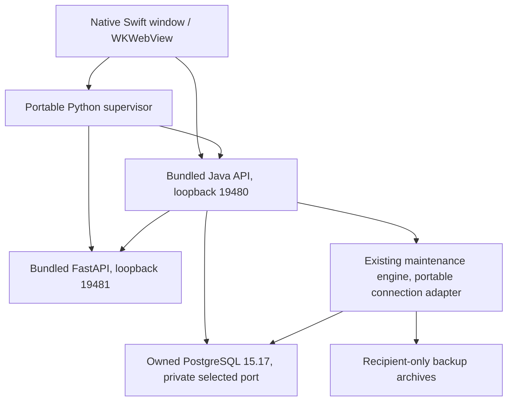

# FinSight AI portable macOS distribution

This is a **separate distribution workstream**, version 0.6.2, not an update to the owner's installed 0.6.1 application. The Intel candidate passed local service and native tests under Rosetta. It is **not ready for routine family distribution**: Gatekeeper rejected its ad-hoc signature, and physical Intel/clean-machine acceptance and notarization have not been performed. See the verification section below for executed results and remaining gates.

## Architecture assessment

The existing application already bundles Java 21, CPython 3.11, FastAPI/scikit-learn/model assets, PostgreSQL 15.17 binaries and recursively relocated native dependencies. Its nonportable behavior is primarily lifecycle/configuration: an existing personal cluster, fixed database names/port, a legacy account check, externally managed PostgreSQL and the owner's existing backup LaunchAgent.

The new source under `desktop/distribution/` builds an independent app (`com.finsight.portable`), keeps React/Java/Python/PostgreSQL and existing migrations/authentication, and replaces only the distribution's startup/storage configuration. No existing application, service, cluster, backup, account or LaunchAgent is adopted, updated or migrated. The source packager and original supervisor remain unchanged.



Financial calculations/writes stay in Java/PostgreSQL. Inference receives no direct database access. The maintenance worker intentionally accesses PostgreSQL using bundled native tools. No runtime downloads, remote finance transmission, paid services or persistent background-agent installation are part of recipient startup.

## Target architecture and minimum OS

The recipient specified **Intel** and asked to assume the latest macOS. The intended target is therefore `x86_64` on macOS 26, with inspected Intel runtime inputs. Not every Intel Mac supports macOS 26; confirm the recipient's actual OS/model before distribution.

The existing Java/PostgreSQL installations are ARM-only. Python is universal, but the existing ML environment is not an Intel runtime set. A generated ARM development bundle is unsuitable for the recipient. It is not a universal installer. Intel output requires Intel Java/PostgreSQL and Intel-compatible Python wheels. Never relabel ARM binaries as Intel.

The builder reads native Mach-O architectures and deployment versions instead of inferring compatibility from the shell. In the existing ARM inputs, PostgreSQL/ICU declare **macOS 26.0**, despite the shell's macOS 13 compile target. The selected Intel inputs declare a highest native minimum of **macOS 14.0**, which is the generated bundle’s minimum; macOS 14/15 execution has not been tested. The latest-OS test host is macOS 26.7.2. `LSMinimumSystemVersion` is set from inspected runtime requirements; a shell target alone is not a compatibility guarantee. A physical Intel/clean-machine test remains distinct from execution under Rosetta on this ARM development Mac.

## Runtime packaging decisions

- **Java:** retain a compatible Temurin 21 runtime tree and licenses, addressing it relative to the immutable release. No recipient JAVA_HOME or Homebrew is used. A full JDK tree is the conservative initial approach. jlink trimming is deferred until module/reflection/security-provider coverage can be validated; size savings alone do not justify removing required modules.
- **Python:** copy a compatible CPython framework, verified site-packages and the existing model. Select the target CPU slice in copied universal binaries. Remove unused developer command wrappers so they cannot reference the build machine. No system Python, pip or model training is required at startup.
- **PostgreSQL:** bundle 15.17 executables, share/runtime files and required native libraries. Include postgres, initdb, pg_ctl, psql, pg_dump, pg_dumpall, pg_restore and pg_isready; remove unrelated developer/service wrappers. All executable libraries must resolve inside the bundle or Apple's system libraries.
- **Frontend/backend:** build copies in a unique `dist/portable-build-*` directory. Do not overwrite the working checkout's JAR while a Java process may load it. The backend, migrations and frontend remain the existing application stack.

The build may require intentional development downloads to acquire missing Intel inputs. That is separate from a system-wide installation and from recipient runtime downloads. Earlier Phase 6 restrictions authorized only installed runtimes, so automatic approval review requires explicit owner approval before those downloads. `prepare_intel.py` is a development-only preparation script; it is not shipped as a runtime downloader.

## Source files

| File | Purpose |
| --- | --- |
| `desktop/distribution/build.py` | Isolated compilation, copied-runtime architecture selection, core adaptation, signing, validation and optional DMG assembly. |
| `desktop/distribution/make_dmg.py` | Verify a tested generated Intel bundle and create/check a read-only DMG without installing it. |
| `desktop/distribution/intel-requirements.lock` | Hash-pinned Intel runtime wheel set for repeatable preparation. |
| `desktop/distribution/licenses/POSTGRESQL-COPYRIGHT` | Retained PostgreSQL license notice; does not depend on a recipient Homebrew installation. |
| `desktop/distribution/prepare_intel.py` | Explicit isolated download/extraction of pinned Intel runtime inputs and Python wheels, with archive checksum checks. Never invokes a system installer. |
| `desktop/distribution/portable_config.py` | Private installation identity validation and refusal of legacy/moved/unrecognized storage. |
| `desktop/distribution/portable_supervisor.py` | First-launch initialization and lifecycle for the independent owned cluster and services. |
| `desktop/distribution/portable_backup.py` | Reuses the existing backup engine with portable databases/tools/credentials; no existing LaunchAgent probing or installation. |
| `desktop/distribution/tests/test_portable.py` | Source-level safety tests without database connections. |
| `desktop/distribution/tests/service_acceptance.py` | Fresh synthetic runtime/migration/authentication/financial/backup/restart acceptance. |
| `desktop/distribution/tests/native_acceptance.py` | Actual native-window/bridge acceptance using only generated bundles and temporary profiles. |

The builder derives restricted `supervisor_core.py` and `backup_core.py` copies from existing source, replacing legacy location/connection constructors in those **generated copies only**. It verifies expected method structure and refuses unexpected transformation inputs. Changes to shared core methods therefore require rerunning distribution tests; there is no hidden second implementation of financial calculations.

## Build requirements and reproducible process

An authorized build host needs cached frontend/Maven dependencies, Java 21 for compilation, Node/npm, Python, Swift/Xcode command-line tools, codesign, otool, lipo and hdiutil. Recipients need none of those development tools. Build inputs must match the requested architecture, including binary Python packages and PostgreSQL dependencies. No Docker or new Homebrew/system installation is used.

From the repository root, run the source-only safety tests:

```sh
python3 -m unittest discover -s desktop/distribution/tests -p 'test_*.py' -v
```

After **explicit approval** for isolated development downloads, prepare Intel input files:

```sh
python3 desktop/distribution/prepare_intel.py
```

This uses pinned Java 21.0.13+9 and PostgreSQL 15.17 archive metadata, checks SHA-256 and prepares wheels for the exact `ai-service/requirements.txt` versions. The wheel set is hash-pinned in `desktop/distribution/intel-requirements.lock`. It stages under `dist/intel-inputs`, not Applications, Homebrew, the system Python or the owner's data directory. It mounts the PostgreSQL source disk image read-only for extraction and detaches it. It does not run Postgres.app or its installer.

An Intel build, once all inputs are present, uses explicit locations:

```sh
python3 desktop/distribution/build.py \
  --architecture x86_64 \
  --java-home dist/intel-inputs/java/jdk-21.0.13+9/Contents/Home \
  --postgres-home dist/intel-inputs/postgres \
  --site-packages dist/intel-inputs/site-packages \
  --dmg
```

`--python-home`, `--node-bin`, `--maven` and `--maven-cache` select already available build tools. Defaults are development conveniences, never recipient runtime configuration. The exact extracted JDK directory must match the archive. `--skip-build` explicitly copies existing build artifacts rather than recompiling; a release should normally use full builds. `--resume` can revalidate/finalize only an existing generated `dist/portable-build-*` stage, not an installed app.

Final intended image: `dist/FinSight-AI-Installer.dmg`. The image contains FinSight AI.app, an Applications shortcut and installation documentation. Existing images are not overwritten automatically. `dist/portable-current` points only to generated staging, never the owner's installed runtime. Generated downloads/builds are ignored by Git; no source, credentials or data is committed by these scripts.

## Fresh installation and storage

The recipient drags the app from the DMG into Applications and launches it. This process must be tested on a compatible fresh Mac before claiming a frictionless installation. The app does not run any developer setup command on the recipient's behalf.

Data lives at:

```text
~/Library/Application Support/FinSight AI Portable/
  installation.json          generated identity, phase, port and private credentials
  postgres/                  recipient's independent PostgreSQL cluster
  run/                       private Unix sockets
  desktop/                   private lock/state and immutable runtime releases
  backups/managed/           recipient's backup archives/status/exports
  logs/                      private operational diagnostics
```

Directories are owner-only. Secrets/configuration files are owner-only, generated on that Mac and never included in the DMG. No records, hashes, credentials, backups, session tokens or cluster files are copied from the developer's installation.

On first launch the supervisor creates a private identity, chooses an available loopback PostgreSQL port excluding 5432/55432/55434, initializes an empty **new** cluster through bundled initdb with SCRAM password authentication, and starts only that cluster. It creates a separate least-privilege application login and an application database, then the existing V1–V7 migrations run. There is no legacy owner/seed fixture. Registration creates an empty USD book with twenty public default category labels.

A single-instance lock precedes database work. An existing database with a known installation identity is reused; a missing database after completed initialization is refused rather than silently reinitialized. A partial initialization is retained for deliberate recovery. An unrecognized existing directory is not adopted. A port conflict is reported; a foreign listener is never stopped or adopted. Long paths that cannot support a private PostgreSQL socket produce a safe refusal.

## Shutdown, failures and independent ownership

The native shell and supervisor retain per-launch secrets, session/origin/CSRF validation, restricted bridge paths, instance-bound readiness and exact child-process identity recovery. Services bind to loopback. Application credentials are passed to owned processes through environment/private input, not secret command-line arguments.

Quit drains Java/Python under the maintenance lock. Only after owned clients have drained does the portable supervisor stop its verified private PostgreSQL cluster. If clients remain, it leaves the cluster running safely rather than interrupting unknown work. Unexpected termination retains PostgreSQL's normal recovery files. Restart verifies storage identity and migration history, recovers exact recorded owned services, and never stops the original installation's processes.

There is no LaunchAgent. With the portable app closed, scheduled backups do not run. A separately reviewed per-user background design would need explicit approval; it must not reuse or replace the owner's existing label/configuration.

## Backup and recovery behavior

The portable adapter configures only the new `finsight` and `postgres` databases, private socket/port and bundled tools. Existing exported-snapshot dump/inventory consistency, archive checks, atomic status/history, retention, safety copies, protected isolated restores, owner-scoped financial exports and external-drive verification are reused.

Default scheduling/retention is the existing engine's policy for the **new installation**, not a modification of the owner's policy. Startup/poll checks missed slots while the app runs. Restore verification creates new protected database names; it does not replace active data or drop databases. Backup files include sensitive authentication hashes and are unencrypted. Same-disk copies do not protect against loss of the Mac.

## Updates

Quit and drain the portable app, retain a verified current backup, and replace only the portable app bundle. Data stays in Application Support. A new immutable runtime release is prepared and selected only after readiness. Applied migration checksums must match; unknown/newer/changed history refuses startup. Before pending migrations against an existing portable database, the supervisor creates a full backup and verifies a protected restoration. Never rewrite history or downgrade a database to make an older bundle run.

This process does **not** migrate the owner's legacy installation. Because both application filenames may be FinSight AI.app, do not drag this build over an existing different-identity FinSight app. The recipient guide explicitly requires stopping in that case.

## Signing, licensing and distribution security

The visible keychain query found **zero valid code-signing identities**. Current generated builds use local ad-hoc signatures; there has been no Developer ID signing, Apple notarization, enrollment, purchase or submission. Quarantine/Gatekeeper acceptance on a recipient machine remains a required separate check. Do not disable Gatekeeper globally or remove quarantine as an automated installer step.

Apple describes Developer ID/notarization as the standard outside-App-Store distribution workflow; hardened runtime and suitable entitlements for Java's JIT/Python/native extensions need their own complete validation before that workflow is claimed. See [Apple Developer ID](https://developer.apple.com/developer-id/) and [notarization](https://developer.apple.com/documentation/security/notarizing-macos-software-before-distribution). An ad-hoc signature is not a trusted publisher identity or notarization ticket.

Retain bundled runtime and dependency notices. [Temurin's license statement](https://adoptium.net/docs/faq/) identifies GPLv2 with Classpath Exception; the distributed runtime's own notices and corresponding-source obligations still apply. Copying a binary is not a blanket license audit. [Python's license](https://docs.python.org/3.11/license.html) requires retained notices and a summary of changes to redistributed Python; this build relocates/thins copied binaries and removes developer wrappers without changing Python's language implementation. [PostgreSQL's license](https://www.postgresql.org/about/licence/) requires its copyright/permission/disclaimer notices. Bundled Python/native dependencies have their own licenses, including possible source obligations; complete the actual Intel payload notice/source audit before external distribution.

## Validation and current limitations

Build validation checks source allowlists, mutable/private payload filenames, symlinks staying inside the app, target architectures, native deployment versions, external absolute library references, missing loader-relative libraries, critical runtime source development paths, signatures and relocated runtime imports. Checksums/provenance are retained for downloaded inputs. These checks do not prove that every arbitrary string in third-party source metadata is absent or that a physical clean Mac has been tested.

Executed so far: twelve distribution source-level safety tests passed; the isolated Java H2 build ran 276 tests (275 passed, one PostgreSQL-only test skipped, zero failures/errors); frontend production build succeeded. The ARM development payload passed signing/import checks and inspected 478 native files after target selection. That ARM payload is **not** an installer for the Intel recipient.

Initial validation failures identified architecture-alias/dependency-scanning issues and a dangling unused Python helper; the builder now scans actual binaries, prunes unused wrappers and checks CPU slices. Initial native acceptance timed out before readiness. Initial process-sandbox tests showed that sandboxing the supervisor blocks its required `/bin/ps` identity helper; the offline test instead confines Java/AI and their maintenance children while retaining supervisor identity checks outside that sandbox. Service startup investigation continues until recorded acceptance passes.

The owner explicitly approved isolated Intel runtime downloads in chat after automatic review initially rejected them under earlier Phase 6 restrictions. Java 21.0.13+9 and PostgreSQL 15.17 archives were checksum-verified and extracted only into `dist/intel-inputs`; 21 Intel Python runtime wheels were prepared there. No system installation occurred. Intel build and service/native tests now passed under Rosetta; physical Intel/clean-machine readiness remains unverified. No installed owner app/database/account/LaunchAgent/schedule/backup has been changed, and no Git commit/push has been made.

## Troubleshooting

- **Wrong architecture/OS:** check About This Mac and the build validation report; never replace a binary with an unrelated runtime to suppress an error.
- **Port busy:** close the identified conflicting app or seek assistance; do not kill a process just because it owns a port.
- **Missing/partial/private storage:** stop and retain files. Never initialize over an existing installation or delete PostgreSQL lock/WAL files as a shortcut.
- **Migration history mismatch:** use a compatible build and deliberate recovery plan, not Flyway clean or edited checksums.
- **Backup failure:** retain existing archives and inspect private operation metadata. Never prune to “fix” a failed restore test.
- **Startup permissions/Gatekeeper:** stop at the dialog and contact the sender. Any OS approval must be deliberate; this build does not bypass security prompts.
- **AI failure:** inspect service readiness separately from prediction eligibility/abstention; manual finance behavior and native startup have different availability requirements.

Known unverified areas include the recipient's actual OS/model, physical Intel/clean-machine acceptance, Gatekeeper quarantine behavior, final hardened-runtime/Developer-ID/notarization, hardware-loss recovery and physical external-SSD behavior. Keep generated development output separate until those release gates are resolved.


### Verified Intel candidate — October 31, 2026

- Intel bundle: `dist/portable-build-b4fa342157c7/desktop/build/FinSight AI.app` (also selected by `dist/portable-current`). Application size observed before disk-image compression: approximately 864 MiB.
- Fresh Intel/Rosetta service workflow passed initialization/migrations, empty zero-balance registration, twenty owned defaults, real model suggestions, transaction create/edit/delete and balances, recurring idempotency, plans/forecasts/calendar/insights/assistant, allocation separation, native backup/archive/full isolated restore verification, owner-scoped JSON/CSV exports, login/logout, owned PostgreSQL shutdown/restart and persistence, two-account isolation, duplicate-instance refusal, foreign-port conflict/recovery, and a same-schema new runtime release preserving all recorded synthetic data and retaining the prior release.
- Java/AI/backup child processes completed service acceptance with external outbound networking denied. The supervisor stayed outside that process sandbox because its exact-identity `/bin/ps` helper cannot execute there. The test used Java's IPv4 socket-stack option to avoid macOS sandbox rejection of IPv4-mapped loopback. Wi-Fi settings were not changed; this is not a physical Wi-Fi-disabled Mac acceptance claim.
- Actual Intel WKWebView under Rosetta passed fresh registration/defaults, visible real AI suggestion, explicit acceptance/manual override, saved exact balance, all nine page renders, logout/login, owned database shutdown, quit/reopen record/category persistence, second-account isolation and zero renderer errors. First service readiness in one native cold run was about 66 seconds; warm restarts and hardware performance vary.
- Existing main Java H2 suite passed under Intel Java: **276 executed, 275 passed, zero failures/errors, one PostgreSQL-only skip**. Python AI suite passed using bundled Intel runtime dependencies: **45 passed, zero failed/skipped**, with one existing Starlette/httpx deprecation warning. Distribution unit suite: **12 passed, zero failed/skipped**. Frontend production build passed. The full main PostgreSQL JUnit suite was not rerun for this distribution task; the fresh native PostgreSQL service workflow is separate evidence, not a substitute claimed as that suite.
- Initial failed attempts are retained as synthetic diagnostics: relative JAVA_HOME in staging; symlink/optional-helper architecture scanning; first native cold-start timeout; an external-copy workflow correctly refusing a temporary non-/Volumes destination; and offline-test sandbox/IPv4 restrictions. The final checks above passed after correcting build/test handling. Production external-volume validation was not weakened. Physical SSD acceptance remains pending.
- Original installed app metadata, native PostgreSQL configuration and the existing backup LaunchAgent definition matched the captured pre-verification fingerprints. Tests used fresh private temporary portable installations and dedicated ports, with no connections to the personal database. The default portable Application Support directory was not created during testing.

Use `python3 desktop/distribution/make_dmg.py` after validating a generated Intel bundle to assemble/verify the DMG without rebuilding or installing anything. It refuses an existing image, verifies all payload hashes, checks the image and mounted app signature, detaches its own read-only mount, and records `dist/portable-installer-report.json`. Gatekeeper assessment is recorded separately from code-signature integrity. Neither test success nor a DMG implies notarization, physical Intel compatibility or warning-free recipient installation.

### Optional background scheduling design, not installed

A future recipient-only background backup job would require explicit consent, a distinct per-user label (not `com.finsight.local-backups`), private configuration, a stable bundled release path, and coordination with both the app-instance and maintenance locks. Because this distribution normally stops its owned cluster on quit, closed-app backup would also need a reviewed temporary-start/owned-shutdown policy with exact cluster identity and crash/port handling. Merely writing a plist would not solve that lifecycle requirement. No such job or behavior is installed or enabled here.


## Final artifact and completion record

| Item | Result |
| --- | --- |
| Installer | `dist/FinSight-AI-Installer.dmg`, version 0.6.2, Intel x86_64 |
| Exact size | 476,101,467 bytes (476.1 MB decimal; approximately 454.0 MiB) |
| SHA-256 | `81553b52b8cb13fbe5582d7e9c5214596071101dd9e468c77dcc2878b9509bc3` |
| Declared native minimum | macOS 14.0 from inspected runtime deployment metadata; actual macOS 14/15 use untested |
| Tested host | macOS 26.7.2, Apple Silicon running the Intel services/window under existing Rosetta |
| Build identity | `d55d255857a1479fa90e` |
| Payload validation | 500 native files and 96 runpath references checked; no escaping links, private payload filenames, missing/external native dependencies or developer paths in critical runtime sources detected |
| Disk image | Created, checksum-verified, mounted read-only, contained app deep/strict signature verified, manifest matched, Applications shortcut checked, own mount detached |
| Gatekeeper | Rejected by elevated read-only assessment, exit 3; `gatekeeperAccepted=false` |
| Signing | Ad-hoc only; no Developer ID or notarization, no purchase/enrollment/submission |
| Final unit run | 12 passed, zero failures/errors/skips |
| Main Java H2 run | 275 passed, zero failures/errors, one PostgreSQL-only skip (276 total) |
| Intel AI tests | 45 passed, zero failures/skips; one pre-existing deprecation warning |
| Intel service workflow | 16 completed checks; physical Intel hardware explicitly unverified |
| Intel native workflow | 12 completed checks; zero renderer errors; physical Intel/SSD and Wi-Fi-disabled hardware session explicitly unverified |
| Schema | Existing V1–V7 applied only to fresh synthetic installations; no migration added/rewritten or applied to personal storage |
| Preserved installation | Installed app metadata, original PostgreSQL configuration and existing LaunchAgent definition matched captured fingerprints; no personal database connection or modification by this work |
| Git | No commits or pushes; existing source files unchanged |

The native minimum describes binary metadata, not proof of successful execution on every Mac/OS combination. No clean Intel machine was available. The network-denial test covers Java, AI and their backup children; it does not mean all Mac networking was disabled. Main PostgreSQL JUnit, a physical SSD, native export save-panel behavior for this portable variant and arbitrary schema-version upgrades were not separately revalidated here. The tested update is an actual new immutable runtime release with unchanged V1–V7 schema and synthetic data preservation.

The complete new source/document list is:

1. `desktop/distribution/build.py`
2. `desktop/distribution/prepare_intel.py`
3. `desktop/distribution/portable_config.py`
4. `desktop/distribution/portable_supervisor.py`
5. `desktop/distribution/portable_backup.py`
6. `desktop/distribution/make_dmg.py`
7. `desktop/distribution/intel-requirements.lock`
8. `desktop/distribution/licenses/POSTGRESQL-COPYRIGHT`
9. `desktop/distribution/tests/test_portable.py`
10. `desktop/distribution/tests/service_acceptance.py`
11. `desktop/distribution/tests/native_acceptance.py`
12. `docs/MACOS-DISTRIBUTION.md`
13. `docs/INSTALL-FINSIGHT-AI.md`

Generated apps, build/test evidence, inputs and the DMG are under ignored `dist/` or private synthetic `/tmp/finsight-portable-test-*` directories. They were not committed. Fresh recipient secrets are generated locally; no existing user's records, password hashes, backups, cluster or credentials are included in the image. No LaunchAgent was installed or modified. Automatic backups for recipients run while the app is open; original closed-app backup behavior on the owner's installation remains untouched.

**Next release gates:** verify the recipient's actual Intel model/OS and a clean-machine install; resolve the Gatekeeper/trusted-signing distribution path with the owner; complete third-party notice/corresponding-source compliance review for external redistribution; then perform guided recipient acceptance. Do not treat the currently rejected, unnotarized candidate as a warning-free installer. Do not disable Gatekeeper or remove quarantine automatically. Detailed nontechnical steps are in [INSTALL-FINSIGHT-AI.md](INSTALL-FINSIGHT-AI.md).

Python's full bundled license is retained at `Contents/Resources/python/Python.framework/Versions/3.11/lib/python3.11/LICENSE.txt`. Other notices remain in the Java legal directory, Python package dist-info folders, PostgreSQL COPYRIGHT and collected native-library notices. The installer verification report is `dist/portable-installer-report.json`.
