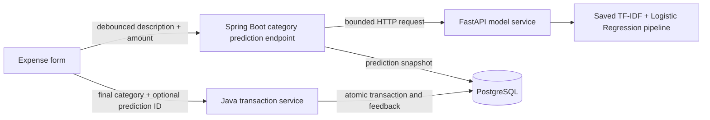

# Phase 2A: expense category suggestions

## Architecture



The Python service has no database client, database credentials, or database persistence. It loads a local, trusted model artifact at startup and performs inference only. Spring Boot remains responsible for transactions, owner scoping, category mapping, and feedback. A model outage never blocks ordinary transaction writes. The frontend calls only Java through its existing `/api` proxy.

## Train and run

Requires Python 3.11. From the repository root:

```sh
cd ai-service
python3 -m venv .venv
source .venv/bin/activate
pip install -r requirements-dev.txt
python train.py
python -m pytest -q
uvicorn app.main:app --host 127.0.0.1 --port 8000 --no-access-log
```

Training writes `artifacts/category-model.joblib` and `artifacts/evaluation.json`. The binary is generated locally and ignored by Git; evaluation results are retained in source. Training is deterministic with the pinned numerical dependencies and fixed seed. Serving never silently trains a missing model; startup fails with a missing or incompatible artifact. Set `MODEL_PATH` to load an alternate **trusted local artifact**. Joblib/pickle files can execute code: never load artifacts from arbitrary uploads or untrusted sources. Use the same scikit-learn version for training and serving.

Start PostgreSQL, Java, and React using the existing README instructions. Java defaults to `AI_SERVICE_URL=http://127.0.0.1:8000`; export this environment variable before starting Java if the URL differs. `AI_CONNECT_TIMEOUT_MS=500` and `AI_READ_TIMEOUT_MS=1500` bound connection and read waits. No retries amplify an outage. An unavailable or malformed model response becomes a successful backend response with `status: "unavailable"`; the form offers manual selection.

### Direct model API

```sh
curl http://127.0.0.1:8000/health
curl -X POST http://127.0.0.1:8000/predict-category \
  -H 'Content-Type: application/json' \
  -d '{"description":"Starbucks Coffee","amount":8.75}'
```

A trained v1 response is approximately:

```json
{
  "category": "Food & Drinks",
  "confidence": 0.8854267406806636,
  "model_version": "1.0",
  "status": "suggested"
}
```

Confidence is the largest value in logistic regression's actual `predict_proba` output, not a hardcoded score or an empirical success rate. Amount is validated but is not a feature in v1. Text is lowercased and converted to unigram/bigram TF-IDF features. The classifier chooses the most probable class. No recognized features produces `unknown`; probability below 0.45 or a top-two margin below 0.12 produces `uncertain`. Both abstentions return `category: null` while retaining the actual maximum model probability. These thresholds are demonstration heuristics, not calibrated guarantees.

FastAPI returns 422 for invalid/missing fields. Description is stripped, 2–160 characters; amount is positive, has at most 12 integer digits and two decimal places; unknown properties are forbidden. Nonfinite amounts are rejected.

### Java endpoint

```sh
curl -X POST http://127.0.0.1:8080/api/category-predictions \
  -H 'Content-Type: application/json' \
  -d '{"description":"Starbucks Coffee","amount":"8.75"}'
```

The backend adds a server-generated `predictionId`, the existing user's `categoryId` and `categoryName`, and camel-case `modelVersion`. It stores model metadata from its own service call; clients cannot submit or forge confidence/model version as transaction metadata. The ledger still requires a valid category chosen by the user.

| Model category                              | Existing ledger category |
| ------------------------------------------- | ------------------------ |
| Food & Drinks                               | Dining                   |
| Transportation                              | Transport                |
| Entertainment                               | Subscriptions            |
| Groceries, Shopping, Housing, Health, Other | Same name                |
| Utilities                                   | Utilities (added by V2)  |

All existing category names, IDs, and transaction links are preserved. Existing `Subscriptions` is the Phase 1 bucket used for entertainment in this demonstration; a broader taxonomy migration would need an explicit product decision. The migration adds Utilities to an existing demo account; the first-run seeder adds it for fresh databases.

## Form behavior and feedback

After a valid expense description and amount remain unchanged for 350ms, the form requests a suggestion. It displays the model label, numerical model confidence, mapped ledger category, and an experimental-model reminder. No category changes automatically. **Use suggestion** is an explicit action; the user can select a different category before or after it. Income does not request suggestions. Obsolete requests are aborted, late responses are ignored, and stale prediction IDs are excluded from submission after description, amount, or type changes.

When an expense is saved with a current suggestion, its optional `predictionId` binds the submission to the server's snapshot. Java verifies owner, expense type, description, and amount, then atomically records the ledger mutation and the final choice. A matching category is `accepted`; a different category is `corrected`. This means “saved the suggested category,” not proof the user clicked the accept button. Saves without a valid suggestion carry no feedback ID. Invalid or foreign IDs are rejected with 400 and the ledger mutation rolls back.

`category_predictions` stores description, amount, model label, mapped category, confidence, model version, status, and timestamp. `category_prediction_feedback` stores the submitted category, accepted/corrected outcome, linked transaction, and `reviewed=false`. Decisions are immutable per prediction ID. Editing can request a fresh prediction and create new feedback. Deleting a transaction clears the feedback transaction link but preserves the original prediction and choice snapshot. This intentional retention supports later review; it is not a general user-data erasure policy.

No feedback is used automatically for training. A future, separate export must select human-reviewed corrections, handle consent and privacy, version labels, avoid train/test leakage, and evaluate on real held-out data. Logging does not include description/amount payloads in the dedicated AI client; existing general application debug logging should remain disabled when using personal information. The demo remains local-only and unauthenticated.

## Evaluation

The checked-in CSV is explicitly synthetic: **180 training rows, 45 held-out test rows, nine categories**, with five held-out descriptions per category. TF-IDF is fitted only on training descriptions. Training and test descriptions are disjoint, but merchants and vocabulary overlap. There is no real transaction benchmark and no merchant-held-out test.

The executed v1 run produced:

| Measure                                      | Result         |
| -------------------------------------------- | -------------- |
| Raw held-out synthetic accuracy              | 45/45 (100%)   |
| Suggestion coverage after abstention         | 43/45 (95.56%) |
| Accuracy among offered synthetic suggestions | 43/43 (100%)   |

The full per-category classification report and confusion matrix are in [evaluation.json](../ai-service/artifacts/evaluation.json). These small, related synthetic examples make the benchmark easy. **The results do not establish real-world accuracy.** Probabilities are uncalibrated. Merchant names, mixed carts (Amazon/Walmart), cryptic bank descriptions, misspellings, unfamiliar stores, multilingual text, and distribution shifts may produce wrong or confidently wrong suggestions. `Other` is a small miscellaneous class, not a universal unknown category. Amount does not disambiguate purchases. Retraining is manual and may change probabilities; update artifact/model versions and evaluation together for future releases.

## Docker

For the preserved personal database, use the [native persistent database startup/recovery guide](database-migration.md). The Compose examples below are for separate synthetic development; never switch the personal application to a new empty Docker database.

The default Compose invocation still starts only PostgreSQL, preserving the Phase 1 workflow. Copy `.env.example` to `.env` and configure local database credentials first.

Run PostgreSQL plus AI with local Java/React processes:

```sh
docker compose --profile ai up -d --build --wait
```

Or run the complete local stack:

```sh
docker compose --profile app up -d --build
```

Open http://localhost:5173; API is localhost:8080 and model localhost:8000. All published ports bind to loopback. Avoid port conflicts with already running local services. The AI image trains its synthetic artifact during the explicit image build, then only loads it when serving. The Java container binds internally to all interfaces so containers can communicate, while the host publication stays on 127.0.0.1. Nginx proxies `/api` with the expected local Host header. The backend requires a healthy database but deliberately does not require healthy AI to start.

Docker image builds/startup must be tested on a machine with a working Docker installation; they were not executed on the implementation machine.

## Manual checks

1. Open **Add transaction**, enter **Starbucks Coffee** and **8.75**. Expect Food & Drinks, mapped to Dining, with a model-derived percentage. Click **Use suggestion** and save.
2. Enter **Netflix** and an amount, choose Housing manually while loading, and confirm it stays Housing when Entertainment arrives. Save; feedback should be corrected.
3. Try **Verizon**, **Shell Gas Station**, **Walmart Groceries**, and **Amazon**.
4. Enter **zxqv 984739 xyzzy** for unknown text or **coffee gasoline pharmacy rent** for ambiguous text. Choose the category yourself.
5. Stop only the AI process and try another expense. The form should say suggestions are unavailable and still save with a manual category.
6. Edit/delete these expenses and confirm the existing balance and dashboard behavior. Clean up only your own test entries.

For local inspection, query `category_predictions` joined to `category_prediction_feedback` on `prediction_id = id`; corrections remain unreviewed. No unauthenticated feedback export endpoint is exposed.

## Implementation references

The model uses scikit-learn's [LogisticRegression probability output](https://scikit-learn.org/stable/modules/generated/sklearn.linear_model.LogisticRegression.html). FastAPI loads the model with its documented [lifespan mechanism](https://fastapi.tiangolo.com/advanced/events/). Synthetic benchmark results above come from this repository's executed training command.
