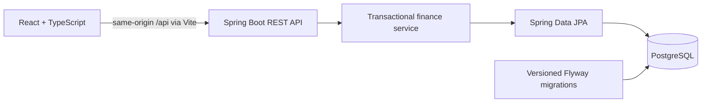

# Architecture and decisions

Permanent direction: private, single-user, fully local and offline operation on the owner's MacBook, with $0 monthly operating cost. Preserve the existing stack; do not introduce cloud services, external AI, remote databases, or paid runtime dependencies. See [AGENTS.md](../AGENTS.md) and the [local operation and desktop plan](local-operation.md). Desktop packaging and backup/restore are future phases, not implemented capabilities.

The frontend is an independent Vite application. It loads account totals, transactions, categories, and a monthly summary from the API. Mutations refetch data; request generations prevent an older month request overwriting a newer one. Error states keep retry explicit. The service is the source of truth for account balances and summaries. Recharts uses JavaScript numbers only for visualization; monetary writes send decimal strings, and daily chart aggregation works in integer cents.

The backend is organized as a small feature package with controller/DTO, service, persistence, and security boundaries. API records prevent entities and ownership fields from leaking into writes. JPA transactions keep each mutation atomic; optimistic version columns protect simultaneous database updates. This does not provide stale-client ETag protection: sequential updates use last-write-wins. Flyway owns schema creation; Hibernate validates it rather than silently altering tables.

## Data model

- `users`: UUID, unique email, display name, optional future password hash, creation timestamp. Demo user cannot authenticate.
- `accounts`: owner, currency, precise opening balance, optimistic version. Ownership composite key supports referential constraints.
- `categories`: owner, name, income/expense type. Categories cannot be selected across owners.
- `transactions`: owner, account, category, positive decimal amount, type, local date, creation timestamp, version. Composite foreign keys require the same owner on account/category. Service validation also requires matching category type.

Money uses PostgreSQL `NUMERIC(19,2)` and Java `BigDecimal`. API amounts allow up to 12 integer digits and two decimal places; aggregates retain the wider database precision. Negative opening balances are permitted; transaction direction is represented by type, never a negative amount. Dates are calendar dates. The demo seed and default API month use the backend's local date; the UI explicitly requests the user's selected month. The product currently assumes a single USD account and local use.

Balance is calculated from the ledger on read: opening balance + income − expenses. There is no mutable cached balance to drift after edits/deletes. Monthly summaries group expense entries by category and filter by calendar month; income is reported separately. Phase 1 reads all owned transactions to keep the implementation small. Introduce database aggregation, pagination, and date indexes based on measured use before scaling.

## Local demo boundary

`DemoIdentity` supplies a fixed user and account on the server. Clients cannot choose an owner or account through input. Every read/write is scoped to that identity. Database constraints enforce consistent ownership; service tests verify foreign data remains inaccessible. This is data-scoping scaffolding, **not authentication**: anyone who can reach this local API can act as the demo user.

Spring binds to 127.0.0.1. Compose publishes PostgreSQL only on 127.0.0.1. The security filter rejects unexpected hostnames and browser origins; cross-origin access is disabled. Mutations require JSON, and the application uses no session/cookie authentication, so CSRF token processing is disabled for this demo. Review CSRF, CORS, local session/token protection, secret management, and request limits for the single-user local threat model. A future desktop bridge must receive an explicit security design; do not loosen origins globally. Never expose this configuration to the LAN or public internet.

Sample data is created atomically only when the fixed demo account does not exist. Restarting leaves user edits and deletions intact. Phase 2A adds a separate, optional model service and unreviewed feedback snapshots; see [AI categorization](ai-categorization.md). No forecasts or financial advice are presented.

## Extension points

Keep server-selected account scoping and develop local security appropriate to one MacBook; hosted identity and public multi-user operation are not product goals. Prioritize recurring income/expenses, idempotent recurring posting, local forecasting, an interactive bill calendar, exact financial calculations, and regression tests. Introduce new tables through migrations without resetting existing records. Extract feature packages as the code grows. The Phase 2A Python/FastAPI categorizer is optional; ledger writes remain independent of model availability. Improve data review and real-world evaluation before expanding its use.

Persistent local storage, automatic local backup/restore, and an eventual Tauri-compatible service lifecycle are described in the [future work plan](local-operation.md). The authoritative native cluster is now in Application Support and the former `/tmp` directory is retained and stopped; see the [verified migration report](database-migration.md). Preserve both and never use restored personal databases as test fixtures. No desktop packaging is permitted during Phases 2B–2D.
